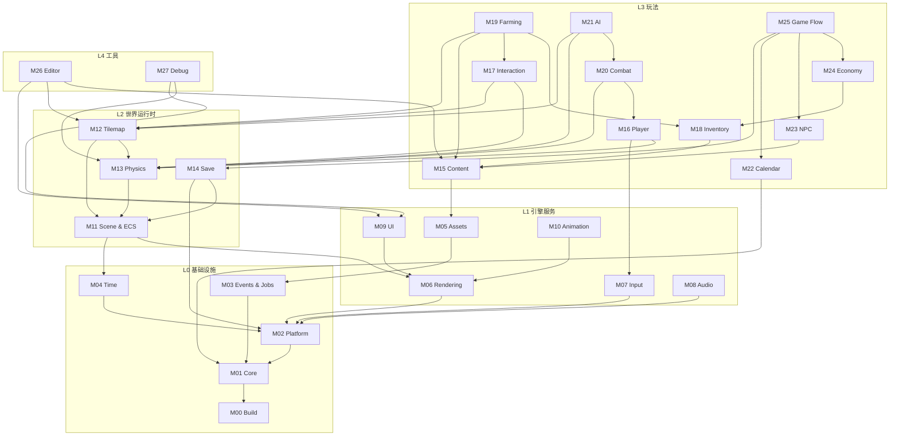

# 模块地图

本文列出 Florian's Adventure 的全部 28 个模块、层级、优先级、职责与依赖。模块设计细节见 `docs/modules/`。

## 1. 模块总表

| ID | 模块 | 层 | 优先级 | 一句话职责 | 关键依赖 |
|---|---|---|---|---|---|
| M00 | Build & Dependency Infrastructure | L0 | P0 | 解决方案、vcpkg、编译选项、CI、目录约定 | 无 |
| M01 | Core Foundation | L0 | P0 | 基础类型、Result、日志、数学别名、ID、容器工具 | M00 |
| M02 | Platform Layer | L0 | P0 | 窗口、文件、剪贴板、时间、消息循环的 SDL3 封装 | M00–M01 |
| M03 | Events & Jobs | L0 | P1 | 类型事件总线、帧事件队列、线程池与任务句柄 | M01–M02 |
| M04 | Time & Frame Loop | L0 | P0 | 帧时钟、固定步长、暂停/缩放、主循环驱动 | M01–M02 |
| M05 | Asset Pipeline | L1 | P0 | 资源 ID、异步加载、缓存、句柄、热重载 | M01–M03 |
| M06 | Rendering | L1 | P0 | OpenGL 设备、精灵批处理、相机、图层、调试绘制（文字归 M09） | M01–M02 |
| M07 | Input | L1 | P0 | 键盘/鼠标/手柄状态、动作映射、输入上下文 | M01–M02 |
| M08 | Audio | L1 | P1 | PCM 音效播放、软件混音、总线音量、2D 声像/距离衰减 | M01–M02 |
| M09 | UI & Text | L1 | P1 | 立即模式 UI、布局、字体、HUD/菜单控件 | M01, M06 |
| M10 | Animation | L1 | P1 | 精灵动画、四向状态机、帧事件 | M01、M06 |
| M11 | Scene / World & ECS | L2 | P0 | 场景栈、World、EntityId、SparseSet、System 调度 | M01, M04, M06 |
| M12 | Tilemap & World | L2 | P1 | 瓦片地图、图层、地图查询、地图加载 | M11, M13 |
| M13 | Physics & Collision | L2 | P0 | AABB 碰撞、瓦片碰撞、移动求解、空间查询、触发器 | M01, M04, M11 |
| M14 | Serialization & Save | L2 | P1 | JSON 序列化、存档槽、版本迁移、原子写入 | M01–M02、M11 |
| M15 | Content Database | L3 | P0 | 物品/作物/敌人/配方等内容定义与校验 | M01–M05 |
| M16 | Player Controller | L3 | P1 | 玩家移动、朝向、交互输入、状态切换 | M07, M11, M13 |
| M17 | Interaction & Grid Placement | L3 | P1 | 交互目标选择、格子放置/拆除、工具使用 | M11–M13（M15 后续） |
| M18 | Inventory & Items | L3 | P1 | 背包、堆叠、装备、物品使用、掉落 | M01, M15 |
| M19 | Farming & World Objects | L3 | P1 | 耕地、播种、浇水、生长、收获、放置物 | M12, M15, M17, M18 |
| M20 | Combat | L3 | P1 | 生命/伤害、攻击判定、受击、死亡、投射物、状态 | M01、M11、M13、M16 |
| M21 | AI | L3 | P1 | 敌人状态机、感知、寻路、行为决策 | M11–M13, M20 |
| M22 | Calendar / Weather / Lighting | L3 | P1 | 日历、季节、天气、环境光与昼夜 | M01（事件/绘制由组装根接 M03/M06/M11） |
| M23 | NPC / Dialogue / Quests | L3 | P2 | NPC、对话、任务、关系与标记 | M11–M15 |
| M24 | Economy / Crafting / Shops | L3 | P2 | 金钱、商店、配方、制作、价格 | M15, M18 |
| M25 | Game Flow | L3 | P1 | 新游戏、读档、存档、场景切换、暂停、退出 | M01, M14, M22–M24 |
| M26 | Editor Tools | L4 | P2 | 地图/内容编辑、实时调参、保存到 JSON | M05–M13, M15 |
| M27 | Debug Tools | L4 | P1 | 调试绘制、控制台、性能面板、ECS 检查器 | M01–M02、M06、M09、M11、M13 |

## 2. 依赖图

> 图中只画主要依赖；完整依赖以各模块文档和 `dependency-rules.md` 为准。

## 3. 分层与模块边界

### L0 基础设施

- **M00** 不产生运行时行为，只定义工程事实：目标名、编译选项、vcpkg 清单、CI。
- **M01** 不依赖 SDL/GL；可在无窗口、无文件系统的单元测试中使用。
- **M02** 是唯一直接 include SDL3 的模块（M03/M04 通过它访问平台能力）。
- **M03** 提供事件与任务原语，不知道任何玩法事件的具体含义。
- **M04** 驱动主循环，但不决定“游戏怎么玩”；它只调用注册的帧回调/阶段。

### L1 引擎服务

- **M05** 是资源访问的唯一入口；玩法不直接读文件。
- **M06** 是唯一直接调用 OpenGL 的模块；其他模块只提交绘制项。
- **M05 与 M06 编译期互不依赖**：`fa_assets` 不引用 `fa_render`，上传走 `ITextureUploader` 反向接口；`fa_render` 也不引用 `fa_assets`。桥接在 `fa_app` 里用适配器完成。
- **M07** 把平台事件翻译为动作状态；不包含玩法键位。
- **M08** 只依赖 M01 与 M02：`fa_audio` 不引用 `fa_assets`、`fa_render`、`fa_scene`，`AudioClip` 由 M08 定义；
  命令队列是唯一的跨线程入口，混音器只在音频线程被访问，统计经原子快照发布。
- **M09** 只依赖 `fa_core` 与 `fa_render`（`RenderQueue`/`TextureHandle`）；不依赖输入、场景或资源系统。每帧鼠标快照由调用方传入，控件读写调用方提供的值，因此没有绑定层。
- **M10** 只描述动画数据与播放状态；不决定何时切换（由玩法系统决定）。
  `AnimationClip` 只存裸 `render::TextureHandle`，`Animator` 是纯数据，ECS 调度由
  composition root / M11 负责；因此 `fa_anim` 只引用 `fa_core` 与 `fa_render`。

### L2 世界运行时

- **M11** 提供通用 ECS 与场景栈，不包含任何具体玩法组件/系统。
- **M12** 负责地图数据与查询；不负责耕地/作物规则（属于 M19）。地图通过非 owning 的
  `TilemapSolids` 适配 `ISolidTiles`，因此 `fa_physics` 仍然不认识瓦片结构；
  `TileDef` 只存裸 `render::TextureHandle`，不引用 `fa_assets`。
- **M13** 只做几何与碰撞求解；不决定伤害或交互。M12 已实现它需要的 `ISolidTiles`。
- **M14** 负责序列化机制与存档槽；具体组件的读写由组件/玩法模块注册。
  `SaveArchive` 用 PIMPL 隐藏 `nlohmann::json`，公共头不泄漏第三方类型；`fa_save` 只引用
  `fa_core`、`fa_platform`、`fa_scene`，不依赖 M05/M06/M09/M12/M15。

### L3 玩法系统

- **M15** 只提供内容定义与查询；不实现玩法规则。定义只存 `ContentId`/值/`AssetId`，不引用 M11 的实体；
  文件读取归 M05/composition root，数据库只接收 JSON 文本。
- **M16** 只把输入变成 `Velocity`、朝向、状态与 `PlayerActionRequest`；不直接链接 M12/M17，
  也不结算伤害或背包。动作请求由组装根转发；位置仍由 M13 写。
- **M17** 只做目标选择、校验、工具分发与放置占用；不实现锄地/播种/伤害，也暂不依赖 M15
  （内容 ID 用不透明 `payload`）。具体工具由 M19/M20 注册 `IToolHandler`；输入来源由 M16 提供。
- **M18** 只做物品栈、容器、快捷栏、装备与使用分发；不实现食物/工具效果（`IItemUseHandler` 由 M19/M20 注册），
  不写存档文件（M14 读快照），也不做背包 UI 布局（M09/M26）。物品只存 `ContentId`/数量/耐久。
- **M20** 只做伤害/攻击/投射物/状态判定，不决定 AI、输入或掉落入包；掉落表以字符串 id 事件
  交给组装根，表现由 M06/M10 消费事件。它只引用 `fa_core`、`fa_scene`、`fa_physics`、`fa_player`。
- **M19** 只做按格农田/作物、世界对象占用与杂物；每日结算输入是 `FarmingDayContext`，
  不直接读 M22，也不实现箱子存储/加工（属于 M24）。它用 M17 的 `IToolHandler`
  接收锄地/浇水/播种/收获，收获只调用 M18 的 `Inventory`。
- **M21** 只做感知/决策/寻路，并把移动交给 M13、攻击交给 M20；它不扣血、不播动画、
  不依赖 M16。目标用 `AiTargetTag` 标记，路径由 service 私有保存，不放进 ECS。
- **M22** 只做日历/天气/环境光与点光数据，不读写存档、不直接改作物或 NPC；事件记录在
  `events()`，由组装根转发给 M19/M21/M23/M24。它是纯逻辑，只引用 `fa_core`；
  暗化层与点光由 app 在 `RenderLayer::Weather` 上提交。
- **M23** 只做 NPC/对话/任务运行时：白名单条件与动作、每日好感/送礼、事件驱动任务。
  v1 自带 `NarrativeDatabase`，尚未扩 M15 内容表；奖励走 M18，商店动作留给 M24，
  NPC 日程留给 M21/M25。
- **M24** 只做钱包/商店/加工/出货运行时：配方来自 M15，物品移动走 M18；
  商店是本地 `ShopDatabase`，金币暂由 `EconomyService` 持有，日终结算由组装根触发。
- **M16–M25** 通过 ECS 组件、事件和窄接口协作；禁止互相 `#include` 具体实现类。
- **M25** 是玩法层的高层协调者；场景切换通过 M11 的 `SceneStack`，不直接操作窗口。

### L4 工具

- **M26** 是叶子工具，只在 Debug/Development 链接；v1 只编辑 `Tilemap` 并用
  M09 画面板，不反向依赖玩法模块。`FA_ENABLE_EDITOR` 与非 Release 的
  `ProjectReference` 双重保证发布构建不链接。
- **M26/M27** 只读或受控修改运行时数据；发布构建可完全剔除。
- **M27** 只引用 `fa_core`、`fa_platform`、`fa_render`、`fa_scene`、`fa_physics`、`fa_ui`；
  命令由 composition root 注册，`DebugStats` 由 app 填充，实体检查器只做值快照。
  `fa_app` 只在非 Release 配置引用它；`fa_tests` 在所有配置链接以保持测试覆盖。
- 调试工具不得成为玩法逻辑的依赖；所有调试入口必须可编译期关闭。

## 4. 跨模块关注点

| 关注点 | 归属 | 规则 |
|---|---|---|
| 实体生命周期 | M11 | 只有 `CommandBuffer` 在阶段末创建/销毁 |
| 坐标与单位 | M01/M06 | 世界像素；渲染层负责虚拟分辨率与像素对齐 |
| 资源句柄 | M05 | 所有资源通过 `AssetHandle<T>`；禁止裸指针长期持有 |
| 事件 | M03 | 事件类型定义在发布模块；订阅者只依赖事件头 |
| 时间 | M04/M22 | 逻辑用固定步长；日历用 `GameClock` |
| 存档 | M14 | 组件通过注册的序列化函数参与；不序列化指针/GPU 资源 |
| 输入 | M07 | 动作映射可配置；玩法只读动作状态 |
| 随机数 | M01 | 显式 `Rng` 实例；禁止全局 `rand()` |
| 日志 | M01 | 分类 + 级别；热路径避免字符串格式化 |
| 调试 | M27 | 通过接口/事件接入；发布构建剔除 |

## 5. 模块状态约定

| 状态 | 含义 |
|---|---|
| 设计完成 | 本文档描述的范围与接口已足够开始实现 |
| 实现中 | 已有代码，接口可能调整 |
| 已实现 | 代码、测试、文档一致 |
| 待定 | 依赖未确认的产品决策 |

当前 M00–M07、M11–M13、M15–M17 已实现；其余模块为**设计完成**，尚未编码。逐模块状态、接口面与下一步建议以
[计划完成情况](../plan-status.md) 为准。

## 6. 新增模块的流程

1. 在本文总表增加一行，分配下一个 `Mxx` 编号与层级。
2. 在 `docs/modules/` 新增同名文档，按统一模板填写。
3. 更新[依赖规则](dependency-rules.md)与[文档索引](../index.md)。
4. 如果引入新的跨层依赖，先写 ADR。
5. 在 composition root 中注册新系统/服务，并补充测试计划。
