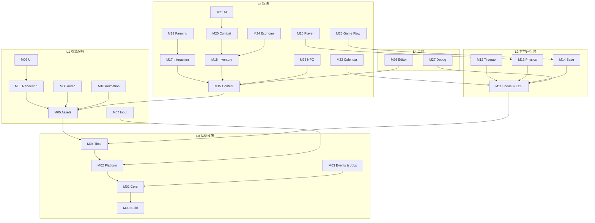

# 模块地图

本文列出 Florian's Adventure 的全部 28 个模块、层级、优先级、职责与依赖。模块设计细节见 `docs/modules/`。

## 1. 模块总表

| ID | 模块 | 层 | 优先级 | 一句话职责 | 关键依赖 |
|---|---|---|---|---|---|
| M00 | Build & Dependency Infrastructure | L0 | P0 | 解决方案、vcpkg、编译选项、CI、目录约定 | 无 |
| M01 | Core Foundation | L0 | P0 | 基础类型、Result、日志、数学别名、ID、容器工具 | M00 |
| M02 | Platform Layer | L0 | P0 | 窗口、文件、剪贴板、时间、消息循环的 SDL3 封装 | M00–M01 |
| M03 | Events & Jobs | L0 | P1 | 类型事件总线、帧事件队列、线程池与任务句柄 | M01–M02 |
| M04 | Time & Frame Loop | L0 | P0 | 帧时钟、固定步长、暂停/缩放、主循环驱动 | M01–M02 |
| M05 | Asset Pipeline | L1 | P0 | 资源 ID、异步加载、缓存、句柄、热重载 | M01–M04 |
| M06 | Rendering | L1 | P0 | OpenGL 设备、精灵批处理、相机、图层、文本绘制 | M01–M05 |
| M07 | Input | L1 | P0 | 键盘/鼠标/手柄状态、动作映射、输入上下文 | M01–M02 |
| M08 | Audio | L1 | P1 | 音效/音乐播放、总线音量、3D 衰减（2D 模拟） | M01–M05 |
| M09 | UI & Text | L1 | P1 | 立即模式 UI、布局、字体、HUD/菜单控件 | M01–M06 |
| M10 | Animation | L1 | P1 | 精灵动画、状态机、帧事件、混合 | M01–M05 |
| M11 | Scene / World & ECS | L2 | P0 | 场景栈、World、EntityId、SparseSet、System 调度 | M01–M04 |
| M12 | Tilemap & World | L2 | P1 | 瓦片地图、图层、地图查询、地图加载 | M05–M11 |
| M13 | Physics & Collision | L2 | P0 | AABB/圆形碰撞、瓦片碰撞、移动求解、查询 | M01–M11 |
| M14 | Serialization & Save | L2 | P1 | JSON 序列化、存档槽、版本迁移、原子写入 | M01–M05, M11 |
| M15 | Content Database | L3 | P0 | 物品/作物/敌人/配方等内容定义与校验 | M01–M05 |
| M16 | Player Controller | L3 | P1 | 玩家移动、朝向、交互输入、状态切换 | M07, M11, M13 |
| M17 | Interaction & Grid Placement | L3 | P1 | 交互目标选择、格子放置/拆除、工具使用 | M11–M13, M15 |
| M18 | Inventory & Items | L3 | P1 | 背包、堆叠、装备、物品使用、掉落 | M11, M15 |
| M19 | Farming & World Objects | L3 | P1 | 耕地、播种、浇水、生长、收获、放置物 | M11–M15, M17 |
| M20 | Combat | L3 | P1 | 生命/伤害、攻击判定、受击、死亡、掉落 | M11–M13, M15, M18 |
| M21 | AI | L3 | P1 | 敌人状态机、感知、寻路、行为决策 | M11–M13, M20 |
| M22 | Calendar / Weather / Lighting | L3 | P1 | 日历、季节、天气、环境光与昼夜 | M01–M06, M11 |
| M23 | NPC / Dialogue / Quests | L3 | P2 | NPC、对话、任务、关系与标记 | M11–M15, M25 |
| M24 | Economy / Crafting / Shops | L3 | P2 | 金钱、商店、配方、制作、价格 | M15, M18, M23 |
| M25 | Game Flow | L3 | P1 | 新游戏、读档、存档、场景切换、暂停、退出 | M11, M14, M22–M24 |
| M26 | Editor Tools | L4 | P2 | 地图/内容编辑、实时调参、保存到 JSON | M05–M13, M15 |
| M27 | Debug Tools | L4 | P1 | 调试绘制、控制台、性能面板、ECS 检查器 | M01–M13 |

## 2. 依赖图

> 图中只画主要依赖；完整依赖以各模块文档和 `dependency-rules.md` 为准。

## 3. 分层与模块边界

### L0 基础设施

- **M00** 不产生运行时行为，只定义工程事实：目标名、编译选项、vcpkg 清单、CI。
- **M01** 不依赖 SDL/GL；可在无窗口、无文件系统的单元测试中使用。
- **M02** 是唯一直接 include SDL3 的模块（M03/M04 通过它访问平台能力）。
- **M03** 提供事件与任务原语，不知道任何玩法事件的具体含义。
- **M04** 驱动主循环，但不决定“游戏怎么玩”；它只调用注册的帧回调/阶段。

### L1 引擎服务

- **M05** 是资源访问的唯一入口；玩法不直接读文件。
- **M06** 是唯一直接调用 OpenGL 的模块；其他模块只提交绘制项。
- **M07** 把平台事件翻译为动作状态；不包含玩法键位。
- **M08** 只消费音频命令；不反向查询 ECS。
- **M09** 依赖渲染与输入，但不依赖具体场景；通过绑定数据与回调工作。
- **M10** 只描述动画数据与播放状态；不决定何时切换（由玩法系统决定）。

### L2 世界运行时

- **M11** 提供通用 ECS 与场景栈，不包含任何具体玩法组件/系统。
- **M12** 负责地图数据与查询；不负责耕地/作物规则（属于 M19）。
- **M13** 只做几何与碰撞求解；不决定伤害或交互。
- **M14** 负责序列化机制与存档槽；具体组件的读写由组件/玩法模块注册。

### L3 玩法系统

- **M15** 只提供内容定义与查询；不实现玩法规则。
- **M16–M25** 通过 ECS 组件、事件和窄接口协作；禁止互相 `#include` 具体实现类。
- **M25** 是玩法层的高层协调者；场景切换通过 M11 的 `SceneManager`，不直接操作窗口。

### L4 工具

- **M26/M27** 只读或受控修改运行时数据；发布构建可完全剔除。
- 调试工具不得成为玩法逻辑的依赖；所有调试入口必须可编译期关闭。

## 4. 跨模块关注点

| 关注点 | 归属 | 规则 |
|---|---|---|
| 实体生命周期 | M11 | 只有 `CommandBuffer` 在阶段末创建/销毁 |
| 坐标与单位 | M01/M06 | 世界像素；渲染层负责虚拟分辨率与像素对齐 |
| 资源句柄 | M05 | 所有资源通过 `AssetHandle<T>`；禁止裸指针长期持有 |
| 事件 | M03 | 事件类型定义在发布模块；订阅者只依赖事件头 |
| 时间 | M04/M22 | 逻辑用固定步长；日历用 `GameClock` |
| 存档 | M14 | 组件通过注册的序列化函数参与；不序列化指针/GPU 资源 |
| 输入 | M07 | 动作映射可配置；玩法只读动作状态 |
| 随机数 | M01 | 显式 `Rng` 实例；禁止全局 `rand()` |
| 日志 | M01 | 分类 + 级别；热路径避免字符串格式化 |
| 调试 | M27 | 通过接口/事件接入；发布构建剔除 |

## 5. 模块状态约定

| 状态 | 含义 |
|---|---|
| 设计完成 | 本文档描述的范围与接口已足够开始实现 |
| 实现中 | 已有代码，接口可能调整 |
| 已实现 | 代码、测试、文档一致 |
| 待定 | 依赖未确认的产品决策 |

当前所有模块均为**设计完成**，代码尚未开始。

## 6. 新增模块的流程

1. 在本文总表增加一行，分配下一个 `Mxx` 编号与层级。
2. 在 `docs/modules/` 新增同名文档，按统一模板填写。
3. 更新[依赖规则](dependency-rules.md)与[文档索引](../index.md)。
4. 如果引入新的跨层依赖，先写 ADR。
5. 在 composition root 中注册新系统/服务，并补充测试计划。
