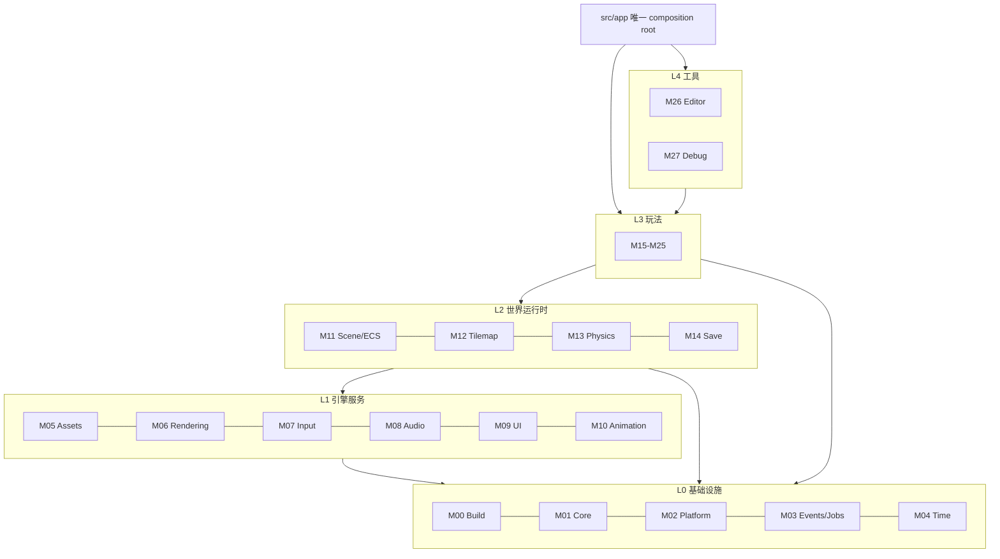
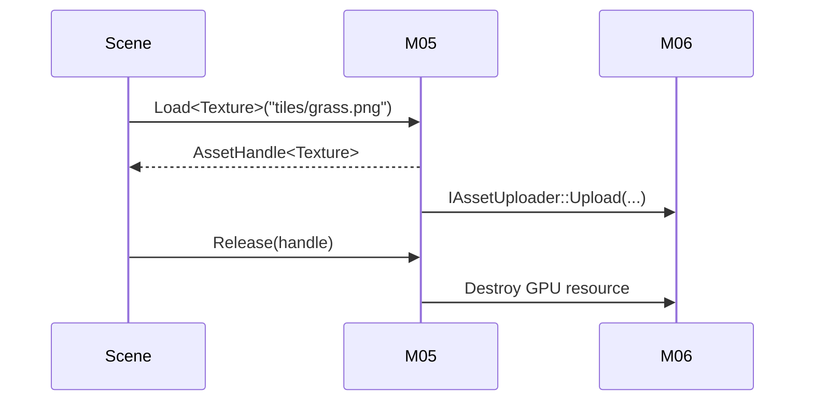

# 架构总览

本文是全局语义基线：其他文档遇到歧义时以本文为准（若与 ADR 冲突，以 ADR 为准）。

## 1. 定位

自研轻量 2D 引擎 + 单一游戏项目，目标平台 Windows 10/11 x64，图形接口 OpenGL 4.1 Core，窗口与输入由 SDL3 提供。

引擎与玩法的边界：引擎不知道“作物”“敌人”这些概念；玩法不直接调用 OpenGL、SDL 或 ImGui。

## 2. 设计原则

1. **单向依赖**：上层可依赖下层，反向禁止。
2. **数据与行为分离**：内容在 JSON，规则在 C++，组件是纯数据。
3. **显式优于隐式**：系统执行顺序、渲染顺序、初始化顺序均显式声明。
4. **可替换**：每个模块可被重写而不影响其他模块，依赖者只依赖接口。
5. **失败可见**：错误使用 `Result` 返回，启动期校验，禁止静默退化。
6. **先做垂直切片，再横向铺开**：优先打通一条完整玩家路径。

## 3. 分层



- `src/app` 是唯一知道所有模块的地方，负责构造、注入、生命周期。
- 模块之间不出现静态/全局可变状态；需要共享的服务通过构造参数或 `ServiceRegistry` 传入。
- 同层模块通信只能通过：已公开的窄接口、事件总线、或纯数据结构（不含行为）。

## 4. 主循环

```cpp
int App::Run() {
    while (!m_platform->ShouldQuit()) {
        m_platform->PumpEvents(m_input, m_window);

        Time::FrameBegin frame = m_time->BeginFrame();
        while (frame.logicStepsTaken < kMaxStepsPerFrame && m_time->HasPendingStep()) {
            StepLogic(m_time->ConsumeStep());
            ++frame.logicStepsTaken;
        }

        Render(m_time->InterpolationAlpha());
        m_jobs->WaitForFrameTasks();
        m_time->EndFrame();
    }
}
```

- 逻辑以固定步长运行，渲染按实际时间运行。
- 单帧最多追赶 `kMaxStepsPerFrame`（默认 5）步，避免死亡螺旋。
- 所有玩法系统只在逻辑步内推进，渲染层只做插值与绘制。

## 5. 帧阶段

固定步内（`StepLogic`）：

1. 输入快照：把平台事件转为动作状态与边缘触发。
2. 消息分发：处理上一帧排入的帧事件。
3. 场景更新：当前场景的系统按显式顺序执行。
4. 物理步：移动求解、碰撞检测、触发器。
5. 延迟销毁：真正删除标记为销毁的实体。
6. 帧末：清理一次性状态，交换输入缓冲。

渲染（`Render`）：

1. 场景提取：从 ECS/地图收集绘制项与光源，不修改世界。
2. 排序：按图层、`sortY`、稳定 ID 排序。
3. 提交：精灵批处理、文本、调试绘制。
4. 呈现：UI 之后交换缓冲。

## 6. 时间模型

| 概念 | 说明 |
|---|---|
| 逻辑步长 | 固定 1/60 秒，`dt` 恒为常量 |
| 渲染帧 | 可变，受 vsync 或帧率上限约束 |
| 插值 alpha | `[0,1)`，用于位置等连续量渲染 |
| 游戏时间 | 由 M22 维护（分/时/日/季/年），与真实时间解耦 |
| 时间缩放 | 影响逻辑步频率，不影响单步 `dt` |

禁止在系统内直接用真实时钟。需要计时（冷却、动画、Buff）时使用逻辑时间累加器。

## 7. 坐标与排序

- 世界为 2D，y 轴向下，单位 1 = 逻辑像素。
- 原点在地图左上角；相机变换后才映射到屏幕。
- 渲染使用虚拟分辨率 640×360，整数缩放到窗口，保证像素锐利。
- 排序键：`(layer, sortY, entityId)`，地形层不参与 `sortY` 排序。
- 碰撞体与精灵尺寸解耦，碰撞盒通常小于精灵。

## 8. ECS 数据流

- `EntityId` = 索引 + 版本号；陈旧句柄访问返回失败而不是 UB。
- 组件以类型注册到稀疏集；`World` 提供 `Create/Destroy/Add/Get/Remove/View`。
- 系统实现为普通函数或类，持有 `World&` 与所需服务引用，按帧调用。
- 系统顺序在场景初始化时以列表形式显式声明。
- 结构变更（增删组件、销毁实体）不能发生在遍历途中；需要时先收集再应用。
- 玩法状态若为“按格”数据（作物、地形），存放在 M12/M19 的格网结构中，而不是每个格子一个实体。

## 9. 资源生命周期



- 资源用引用计数句柄管理，句柄失效不抛异常。
- 异步加载只在 M05 内部使用工作线程；GPU 上传必须回到主线程。
- 热重载仅 Development 配置启用，重载后句柄保持不变。

## 10. 场景栈

- `SceneStack` 支持 push/pop/replace；只有栈顶接收输入与更新。
- 暂停菜单压栈时下层不更新但仍渲染。
- 场景拥有自己的 `World`，切换场景时整体释放；跨场景数据由 M25 或 M14 持有。
- 场景加载分两阶段：构建（在主线程创建实体与资源请求）与激活（等资源就绪后进入）。

## 11. 线程模型

| 线程 | 职责 |
|---|---|
| 主线程 | 窗口事件、逻辑步、ECS、渲染提交、UI |
| 工作线程（M03） | 资源解码、文件 IO、寻路等纯计算 |

规则：

- 工作线程不得访问 `World`、OpenGL、ImGui、音频设备。
- 跨线程数据靠任务返回值或线程安全队列传递。
- 帧内提交的任务必须在 `EndFrame` 前完成或被取消。

## 12. 错误处理

- 关闭异常与 RTTI；可恢复错误用 `Result<T, Error>`。
- 启动期不可恢复错误：记录日志并干净退出，不弹裸 `assert`。
- 运行时错误分级：`Warn`（可继续）、`Error`（功能降级）、`Fatal`（退出）。
- 断言仅用于捕获程序错误（不变量违背），不用于校验用户数据。
- 内容数据错误一律在加载期报错，带文件路径与字段名。

## 13. 存档边界

- 存档由 M14 定义版本化 JSON，包含：世界种子、日期时间、玩家、背包、地图修改、作物、NPC 状态、经济。
- 不存：GPU 资源、缓存、动画当前帧、瞬时粒子、事件队列。
- 写入采用“临时文件 + fsync + 原子替换”，并保留上一份备份。
- 读档失败策略：尝试备份 → 失败则回主菜单并提示，不崩溃。
- 存档格式变更必须新增迁移函数与 ADR。

## 14. 扩展性

新增内容类型：加 JSON 定义 + 内容库注册，不改引擎。

新增玩法系统：新建模块或子目录，注册到场景的系统列表，不修改已有系统。

替换渲染后端：重新实现 M06 对外接口，玩法不受影响。

增加脚本层：需新增 ADR，明确与 C++ 系统的边界（建议仅用于内容表达式，不接管实体更新）。

## 15. 非目标（v1）

- 跨平台（macOS/Linux/主机）。
- 多人联机。
- 3D 渲染与骨骼动画。
- 内嵌脚本语言运行时。
- 完整物理引擎（柔体、连续碰撞、旋转刚体）。
- 可视化节点式关卡编辑器。

## 16. 开放问题

1. 瓦片尺寸 16×16 还是 32×32，角色帧与碰撞盒比例如何？
2. 战斗是否引入耐力/翻滚/格挡？近战为主还是近远程并存？
3. 种植深度：季节限制、温室、动物、加工链做到什么程度？
4. 存档：单槽还是多槽，自动存档频率？
5. 是否需要手柄支持（架构已预留输入抽象）？
