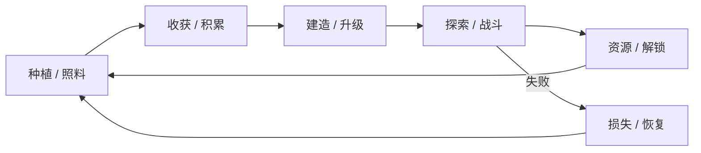

# 愿景与设计支柱

> 层级：架构 · 状态：设计基线 · 适用范围：整个项目

## 1. 一句话定位

《Florian's Adventure》是一款**俯视角 2D 像素风的种植生活 + 实时动作战斗**游戏：玩家经营农场、探索周边区域、与敌人战斗，并在季节循环中逐步成长。

## 2. 玩家幻想与核心循环

玩家幻想：

- 拥有一块可以亲手打理的农场，看着土地从荒芜变得有序。
- 用自己种植、采集、战斗获得的资源，换取更好的工具与更大的世界。
- 在安全的生活节奏与有风险的探索战斗之间自由切换。

核心循环：

循环的关键在于：**农场提供稳定、可预期的成长；战斗提供波动、风险与稀有奖励**。两者共享物品、装备、体力与时间资源，形成互相牵引。

## 3. 设计支柱

### 3.1 双重节奏

农场经营是安全的节奏缓冲，战斗是风险与奖励的来源。任何玩法模块都应回答：它服务于哪一侧的节奏？避免把两者做成互不相干的平行系统。

### 3.2 可读性优先

- 像素美术保持一致的像素密度与调色板。
- 攻击、受击、采集、生长等关键状态必须有清晰的视觉/音效反馈。
- 判定框、交互范围、网格放置范围应可被玩家预测。

### 3.3 系统化而非脚本堆叠

内容（物品、作物、敌人、掉落、配方）以 JSON 定义，系统只实现规则。新内容应主要通过新增数据完成，而不是修改核心代码。

### 3.4 可扩展与可替换

- 模块之间通过接口与事件通信，避免直接依赖实现。
- 渲染、音频、存档、AI 等能力保留替换实现的可能。
- 新玩法以「新增组件 + 新增系统 + 新增数据」的方式接入。

### 3.5 单人优先

v1 不考虑联机、多人同步与服务器权威逻辑。所有设计以单机确定性为优先。

## 4. v1 范围

### 范围内

- 一张农场地图 + 一张野外/战斗地图。
- 移动、碰撞、相机、动画、交互。
- 3 种作物、1 种工具链、土壤/浇水/生长/收获。
- 实时近战与远程战斗、2 种敌人、掉落与拾取。
- 物品栏、快捷栏、装备与简单属性。
- 一天的时间循环、季节数据、天气表现。
- 存档/读档、主菜单、暂停。
- 基础 HUD 与调试工具。

### 范围外

- 联机/多人。
- 内嵌脚本语言（Lua 等）。
- 主机/移动端。
- 完整 NPC 好感度、婚姻、任务链（仅保留设计与扩展点）。
- 大规模 Mod 平台（仅保留数据目录与覆盖规则）。

## 5. 成功标准

垂直切片应满足：

1. 玩家可以在农场与战斗地图之间往返，过程无崩溃、无存档损坏。
2. 种植链路完整：耕地 → 播种 → 浇水 → 生长 → 收获 → 售卖/使用。
3. 战斗链路完整：索敌 → 攻击 → 受击 → 死亡 → 掉落 → 拾取。
4. 一天结束后状态正确重置，存档后读档能恢复到一致状态。
5. 新增一种作物或一种敌人只需新增 JSON 与素材，不改核心系统代码。

## 6. 非目标

- 不在 v1 追求 3A 级画面、完整物理模拟或大规模开放世界。
- 不为了「引擎完整」而实现当前玩法不需要的通用能力。
- 不复制任何现有游戏的素材、剧情或关卡。

## 7. 参考与差异化

参考的是**生活模拟 + 动作 RPG 的结构性经验**（时间循环、种植成长、风险回报、探索节奏），而不是具体作品的美术、文本或关卡。差异化方向：

- 更强调战斗与种植的资源联动（作物可用于战斗消耗品/装备材料）。
- 更轻量的引擎与更清晰的数据驱动管线，便于快速迭代内容。
