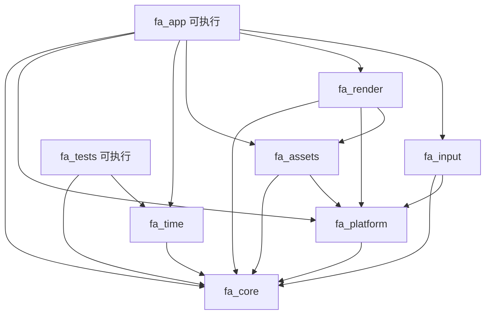

# M00 构建骨架 —— 落地状态与剩余步骤

> 权威来源：`docs/modules/00-build-infrastructure.md`、`docs/architecture/tech-stack.md`。
> 本文只记录“已建什么 / 还差什么 / 怎么验”。

## 1. 已创建的根级文件

| 文件 | 作用 | 已验证 |
|---|---|---|
| `vcpkg.json` | manifest，sdl3 / glm / nlohmann-json / stb / imgui( sdl3-binding, opengl3-binding ) + `tests` 特性(catch2) | 内容已读回确认 |
| `Directory.Build.props` | 三配置（Debug / Development / Release）、`/W4 /WX`、`/EHs-c-`、`/GR-`、`/utf-8`、`x64-windows-static-md`、输出目录 | 内容已读回确认 |
| `.clang-format` | 与 `conventions.md` 第 5 节一致（LLVM + 4 空格 + 120 列 + Attach） | 内容已读回确认 |
| `.gitignore` | build/、vcpkg_installed/、saves/、logs/、VS 中间件 | 内容已读回确认 |
| `build/Project.props` | 统一 include 路径 | 内容已读回确认 |
| `scripts/build.ps1` | vcpkg install + vswhere→MSBuild + 可选测试 | 语法已核（未运行） |
| `.github/workflows/ci.yml` | Windows CI；sln 未存在时自动跳过 | 语法已核（未运行） |

## 2. 已完成的修正

初版骨架有 6 处会导致构建失败或静默错误的问题，均已修复并在真机验证：

| # | 位置 | 问题 | 修复 |
|---|---|---|---|
| 1 | `vcpkg.json` | `builtin-baseline` 是 `TODO-REPLACE` 占位 | 填入 vcpkg 发布标签 `2025.12.12` 的 SHA `84bab45d...` |
| 2 | `Directory.Build.props` | 硬编码 `v143`，VS2026 机器报 `MSB8020` | 按 `VisualStudioVersion` 自适应 v145/v143，并提供 `FA_PlatformToolset` 覆盖点 |
| 3 | `Directory.Build.props` | 编译选项写在 `PropertyGroup`，被 MSBuild 静默忽略 | 全部迁入 `ItemDefinitionGroup/ClCompile` |
| 4 | `Directory.Build.props` | `$(ProjectName)` 在 props 中求值为空 → `MSB8028` | 改用 `$(MSBuildProjectName)` |
| 5 | `fa_platform.vcxproj` | 手写 `SDL3.lib`，静态 triplet 实为 `SDL3-static.lib` | 删除整个 `ItemDefinitionGroup`，交给 vcpkg 注入 |
| 6 | `fa_tests.vcxproj` | 引擎全局无异常/无 RTTI，Catch2 无法编译 | 单独开启 `ExceptionHandling=Sync` + `RuntimeTypeInfo=true` |
| 7 | `fa_tests.vcxproj` | Debug 链接 Release 版 `Catch2.lib` → `LNK2038` | 按配置区分：Debug 用 `debug\lib` + `Catch2d.lib` |

排查细节与症状对照见 [m00-fixups.md](m00-fixups.md)。

## 3. 项目图（Phase A 范围）



未入 Phase A 的项目（M03 events、M08 audio、M09 ui、M10 animation、M11 scene/ecs、M12 tilemap、M13 physics、M14 save、M15 content、L3/L4 全部）按同样模板在对应 Phase 添加。

## 4. 目录与 GUID 表

公共头统一放在 `src/engine/include/fa/<module>/`，游戏头放 `src/game/include/fa/game/`；私有实现放在对应模块的 `src/`。

| 项目 | ProjectGuid | 类型 | 源目录 | 项目引用 |
|---|---|---|---|---|
| `fa_core` | `C0DE0001-0001-4F00-9A00-000000000001` | StaticLibrary | `src/engine/core/src` | — |
| `fa_platform` | `C0DE0002-0002-4F00-9A00-000000000002` | StaticLibrary | `src/engine/platform/src` | fa_core |
| `fa_time` | `C0DE0003-0003-4F00-9A00-000000000003` | StaticLibrary | `src/engine/time/src` | fa_core |
| `fa_assets` | `C0DE0004-0004-4F00-9A00-000000000004` | StaticLibrary | `src/engine/assets/src` | fa_core, fa_platform |
| `fa_render` | `C0DE0005-0005-4F00-9A00-000000000005` | StaticLibrary | `src/engine/render/src` | fa_core, fa_platform, fa_assets |
| `fa_input` | `C0DE0006-0006-4F00-9A00-000000000006` | StaticLibrary | `src/engine/input/src` | fa_core, fa_platform |
| `fa_app` | `C0DE00A0-00A0-4F00-9A00-00000000 00A0` | Application | `src/app` | 以上全部 |
| `fa_tests` | `C0DE00FE-00FE-4F00-9A00-0000000000FE` | Application | `tests` | fa_core, fa_time + Catch2 |

> `fa_app` 的 GUID 写作 `C0DE00A0-00A0-4F00-9A00-0000000000A0`（上表因排版断了空格，以这行为准）。

固定 GUID：C++ 项目类型 `{8BC9CEB8-8B4A-11D0-8D11-00A0C91BC942}`，解决方案文件夹 `{2150E333-8FDC-42A3-9474-1A3956D46DE8}`。

## 5. `FloriansAdventure.sln` 全文

```text
Microsoft Visual Studio Solution File, Format Version 12.00
# Visual Studio Version 17
VisualStudioVersion = 17.0.31903.59
MinimumVisualStudioVersion = 10.0.40219.1
Project("{8BC9CEB8-8B4A-11D0-8D11-00A0C91BC942}") = "fa_core", "src\engine\core\fa_core.vcxproj", "{C0DE0001-0001-4F00-9A00-000000000001}"
EndProject
Project("{8BC9CEB8-8B4A-11D0-8D11-00A0C91BC942}") = "fa_platform", "src\engine\platform\fa_platform.vcxproj", "{C0DE0002-0002-4F00-9A00-000000000002}"
EndProject
Project("{8BC9CEB8-8B4A-11D0-8D11-00A0C91BC942}") = "fa_time", "src\engine\time\fa_time.vcxproj", "{C0DE0003-0003-4F00-9A00-000000000003}"
EndProject
Project("{8BC9CEB8-8B4A-11D0-8D11-00A0C91BC942}") = "fa_assets", "src\engine\assets\fa_assets.vcxproj", "{C0DE0004-0004-4F00-9A00-000000000004}"
EndProject
Project("{8BC9CEB8-8B4A-11D0-8D11-00A0C91BC942}") = "fa_render", "src\engine\render\fa_render.vcxproj", "{C0DE0005-0005-4F00-9A00-000000000005}"
EndProject
Project("{8BC9CEB8-8B4A-11D0-8D11-00A0C91BC942}") = "fa_input", "src\engine\input\fa_input.vcxproj", "{C0DE0006-0006-4F00-9A00-000000000006}"
EndProject
Project("{8BC9CEB8-8B4A-11D0-8D11-00A0C91BC942}") = "fa_app", "src\app\fa_app.vcxproj", "{C0DE00A0-00A0-4F00-9A00-0000000000A0}"
EndProject
Project("{8BC9CEB8-8B4A-11D0-8D11-00A0C91BC942}") = "fa_tests", "tests\fa_tests.vcxproj", "{C0DE00FE-00FE-4F00-9A00-0000000000FE}"
EndProject
Global
	GlobalSection(SolutionConfigurationPlatforms) = preSolution
		Debug|x64 = Debug|x64
		Development|x64 = Development|x64
		Release|x64 = Release|x64
	EndGlobalSection
	GlobalSection(ProjectConfigurationPlatforms) = postSolution
```

`ProjectConfigurationPlatforms` 需为每个项目 GUID 重复三组（把下段里 `<GUID>` 按上表替换）：

```text
		{<GUID>}.Debug|x64.ActiveCfg = Debug|x64
		{<GUID>}.Debug|x64.Build.0 = Debug|x64
		{<GUID>}.Development|x64.ActiveCfg = Development|x64
		{<GUID>}.Development|x64.Build.0 = Development|x64
		{<GUID>}.Release|x64.ActiveCfg = Release|x64
		{<GUID>}.Release|x64.Build.0 = Release|x64
```

结尾：

```text
	EndGlobalSection
	GlobalSection(SolutionProperties) = preSolution
		HideSolutionNode = FALSE
	EndGlobalSection
EndGlobal
```

## 6. `fa_core.vcxproj` 模板

其余项目复制本文件，只改 `ProjectGuid`、`RootNamespace`、`ConfigurationType`（`fa_app`/`fa_tests` 为 `Application`）、源文件路径、`ProjectReference`。

```xml
<?xml version="1.0" encoding="utf-8"?>
<Project DefaultTargets="Build" xmlns="http://schemas.microsoft.com/developer/msbuild/2003">
  <ItemGroup Label="ProjectConfigurations">
    <ProjectConfiguration Include="Debug|x64"><Configuration>Debug</Configuration><Platform>x64</Platform></ProjectConfiguration>
    <ProjectConfiguration Include="Development|x64"><Configuration>Development</Configuration><Platform>x64</Platform></ProjectConfiguration>
    <ProjectConfiguration Include="Release|x64"><Configuration>Release</Configuration><Platform>x64</Platform></ProjectConfiguration>
  </ItemGroup>
  <PropertyGroup Label="Globals">
    <VCProjectVersion>17.0</VCProjectVersion>
    <ProjectGuid>{C0DE0001-0001-4F00-9A00-000000000001}</ProjectGuid>
    <RootNamespace>fa_core</RootNamespace>
    <Keyword>Win32Proj</Keyword>
  </PropertyGroup>
  <Import Project="$(VCTargetsPath)\Microsoft.Cpp.Default.props" />
  <PropertyGroup Condition="'$(Configuration)'=='Debug'" Label="Configuration">
    <ConfigurationType>StaticLibrary</ConfigurationType>
  </PropertyGroup>
  <PropertyGroup Condition="'$(Configuration)'=='Development'" Label="Configuration">
    <ConfigurationType>StaticLibrary</ConfigurationType>
  </PropertyGroup>
  <PropertyGroup Condition="'$(Configuration)'=='Release'" Label="Configuration">
    <ConfigurationType>StaticLibrary</ConfigurationType>
  </PropertyGroup>
  <Import Project="$(VCTargetsPath)\Microsoft.Cpp.props" />
  <ImportGroup Label="ExtensionSettings" />
  <ImportGroup Label="PropertySheets">
    <Import Project="$(UserRootDir)\Microsoft.Cpp.$(Platform).user.props" Condition="exists('$(UserRootDir)\Microsoft.Cpp.$(Platform).user.props')" Label="LocalAppDataPlatform" />
    <Import Project="$(SolutionDir)build\Project.props" />
  </ImportGroup>
  <ItemGroup>
    <ClInclude Include="$(SolutionDir)src\engine\include\fa\core\*.hpp" />
  </ItemGroup>
  <ItemGroup>
    <ClCompile Include="src\*.cpp" />
  </ItemGroup>
  <Import Project="$(VCTargetsPath)\Microsoft.Cpp.targets" />
  <ImportGroup Label="ExtensionTargets" />
</Project>
```

依赖写法（放在 `Microsoft.Cpp.targets` 导入之前）：

```xml
  <ItemGroup>
    <ProjectReference Include="$(SolutionDir)src\engine\core\fa_core.vcxproj" />
  </ItemGroup>
```

第三方链接示例（`fa_render`）：

```xml
  <ItemDefinitionGroup>
    <Link>
      <AdditionalDependencies>SDL3-static.lib;opengl32.lib;%(AdditionalDependencies)</AdditionalDependencies>
    </Link>
  </ItemDefinitionGroup>
```

## 7. 最小源文件

每个库至少一个 `.cpp`（否则 MSVC 会报 LNK4221 / 空目标警告，配合 `/WX` 会失败）：

| 项目 | 最小文件 |
|---|---|
| fa_core | `src/engine/core/src/Version.cpp` |
| fa_platform | `src/engine/platform/src/Platform.cpp` |
| fa_time | `src/engine/time/src/FrameLoop.cpp` |
| fa_assets | `src/engine/assets/src/AssetRegistry.cpp` |
| fa_render | `src/engine/render/src/Renderer.cpp` |
| fa_input | `src/engine/input/src/InputSystem.cpp` |
| fa_app | `src/app/main.cpp`（`int main()`，调用 M02 初始化后立即退出） |
| fa_tests | `tests/main.test.cpp`（Catch2 `main`） |

## 8. 验证清单

- [x] `vcpkg.json` 占位 baseline 已修正
- [x] `Directory.Build.props` 工具集自适应已生效
- [x] `msbuild FloriansAdventure.sln /p:Configuration=Development /p:Platform=x64` 成功
- [x] Debug / Development / Release 三配置均能构建（零警告零错误）
- [x] `fa_tests.exe` 退出码 0（22 用例 / 14626 断言）
- [ ] 三个配置的 `build/bin/x64/<Config>/` 输出路径与 `scripts/build.ps1` 约定一致
- [ ] CI 第一个 PR 为绿色

## 9. 已验证 / 未验证

| 项 | 状态 |
|---|---|
| 文件已落盘 | 是 |
| vcpkg 依赖解析 | **已验证**：6 个端口安装成功 |
| MSBuild 构建 | **已验证**：Debug / Development / Release 三配置 Rebuild 零警告零错误 |
| `fa_app.exe` 运行 | **已验证**：打印 `engine v0.1.0 (M01 core)`，exit 0 |
| `fa_tests.exe` 运行 | **已验证**：22 用例 / 14626 断言通过，exit 0 |
| CI 首次运行 | 未验证，需首次 push 后在 Actions 上确认 |
