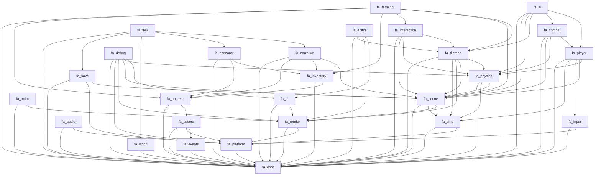
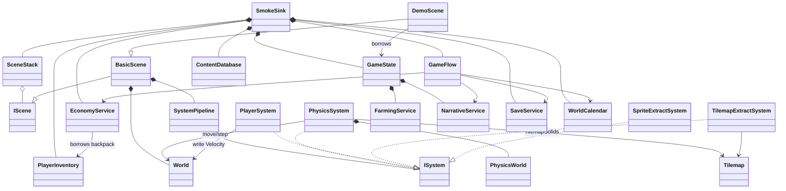

# 代码速查（Code Reference）

> **用途**：把 28 个模块的命名空间、工程依赖、公开头文件、类/结构体、关键方法、枚举与常量集中到一页，方便接手代码时快速定位。
>
> **来源**：`src/engine/include/fa/**/*.hpp`、各模块 `fa_*.vcxproj` 的 `ProjectReference`、[模块地图](architecture/module-map.md) 与各模块设计文档。
>
> **维护**：公开 API 变更时同步本文件；更细的语义、踩坑与限制仍以 [模块文档](index.md#模块设计文档)、[构建记录](index.md#构建与实测) 和 [已知限制](known-limitations.md) 为准。
>
> **本版补充**：§1.4 依赖类型/所有权规则；§2.1–2.4 链接依赖图、跨模块运行时接线、全局类关系与依赖速记；每个模块新增“类关系与职责”表（关系/类职责/方法职责）。
>
> 符号约定：`kXxx` 为常量/错误码；`I*` 为接口；`*System`/`*Service` 为每帧或每步运行的服务；`*Def` 为内容定义；`*Stats` 为调试/冒烟快照。

## 0. 快速导航

| 模块 | 名称 | 工程 | 命名空间 | 设计文档 |
|---|---|---|---|---|
| M00 | Build & Dependency Infrastructure | 解决方案/脚本 | — | [00](modules/00-build-infrastructure.md) |
| M01 | Core Foundation | `fa_core` | `fa::core` | [01](modules/01-core-foundation.md) |
| M02 | Platform Layer | `fa_platform` | `fa::platform` | [02](modules/02-platform-layer.md) |
| M03 | Events & Jobs | `fa_events` | `fa::events` | [03](modules/03-events-and-jobs.md) |
| M04 | Time & Frame Loop | `fa_time` | `fa::time` | [04](modules/04-time-and-frame-loop.md) |
| M05 | Asset Pipeline | `fa_assets` | `fa::assets` | [05](modules/05-asset-pipeline.md) |
| M06 | Rendering | `fa_render` | `fa::render` | [06](modules/06-rendering.md) |
| M07 | Input | `fa_input` | `fa::input` | [07](modules/07-input.md) |
| M08 | Audio | `fa_audio` | `fa::audio` | [08](modules/08-audio.md) |
| M09 | UI & Text | `fa_ui` | `fa::ui` | [09](modules/09-ui-and-text.md) |
| M10 | Animation | `fa_anim` | `fa::anim` | [10](modules/10-animation.md) |
| M11 | Scene / World & ECS | `fa_scene` | `fa::scene` | [11](modules/11-scene-world-ecs.md) |
| M12 | Tilemap & World | `fa_tilemap` | `fa::tilemap` | [12](modules/12-tilemap-and-world.md) |
| M13 | Physics & Collision | `fa_physics` | `fa::physics` | [13](modules/13-physics-collision.md) |
| M14 | Serialization & Save | `fa_save` | `fa::save` | [14](modules/14-serialization-save.md) |
| M15 | Content Database | `fa_content` | `fa::content` | [15](modules/15-content-database.md) |
| M16 | Player Controller | `fa_player` | `fa::player` | [16](modules/16-player-controller.md) |
| M17 | Interaction & Grid Placement | `fa_interaction` | `fa::interaction` | [17](modules/17-interaction-grid-placement.md) |
| M18 | Inventory & Items | `fa_inventory` | `fa::inventory` | [18](modules/18-inventory-items.md) |
| M19 | Farming & World Objects | `fa_farming` | `fa::farming` | [19](modules/19-farming-world-objects.md) |
| M20 | Combat | `fa_combat` | `fa::combat` | [20](modules/20-combat.md) |
| M21 | AI | `fa_ai` | `fa::ai` | [21](modules/21-ai.md) |
| M22 | Calendar / Weather / Lighting | `fa_world` | `fa::world` | [22](modules/22-calendar-weather-lighting.md) |
| M23 | NPC / Dialogue / Quests | `fa_narrative` | `fa::narrative` | [23](modules/23-npc-dialogue-quests.md) |
| M24 | Economy / Crafting / Shops | `fa_economy` | `fa::economy` | [24](modules/24-economy-crafting-shops.md) |
| M25 | Game Flow | `fa_flow` | `fa::flow` | [25](modules/25-game-flow.md) |
| M26 | Editor Tools | `fa_editor` | `fa::editor` | [26](modules/26-editor-tools.md) |
| M27 | Debug Tools | `fa_debug` | `fa::debug` | [27](modules/27-debug-tools.md) |

## 1. 分层、命名空间与错误码

### 1.1 分层

```text
L0  fa::core  fa::platform
L1  fa::events  fa::time  fa::assets  fa::render  fa::input  fa::audio  fa::ui  fa::anim
L2  fa::scene  fa::tilemap  fa::physics  fa::save
L3  fa::content  fa::player  fa::interaction  fa::inventory  fa::farming
    fa::combat  fa::ai  fa::world  fa::narrative  fa::economy  fa::flow
L4  fa::editor  fa::debug
```

- 下层不 include 上层；跨层通信走纯值类型、事件或组装根注入的接口。
- 玩法模块不自己造 ECS：组件用 `scene::World::add<T>`，每帧逻辑写成 `scene::ISystem`。
- 位置只有一个写入者：`physics::PhysicsWorld::move` / `PhysicsSystem`；其他模块只写 `Velocity`。
- 调试/编辑器只在非 Release 链接；`fa_debug` 为叶子模块，命令由 app 注册。

### 1.2 命名空间一览

| 命名空间 | 主要子命名空间 | 归属 |
|---|---|---|
| `fa::core` | `core::log`、`core::error` | M01 |
| `fa::platform` | `platform::platform_error` | M02 |
| `fa::events` | — | M03 |
| `fa::time` | — | M04 |
| `fa::assets` | `assets::asset_error`、`assets::detail` | M05 |
| `fa::render` | `render::render_error` | M06 |
| `fa::input` | — | M07 |
| `fa::audio` | — | M08 |
| `fa::ui` | — | M09 |
| `fa::anim` | — | M10 |
| `fa::scene` | `scene::scene_error`、`scene::detail` | M11 |
| `fa::tilemap` | `tilemap::tilemap_error` | M12 |
| `fa::physics` | `physics::physics_error` | M13 |
| `fa::save` | `save::save_error` | M14 |
| `fa::content` | `content::content_error` | M15 |
| `fa::player` | `player::player_error` | M16 |
| `fa::interaction` | `interaction::interaction_error` | M17 |
| `fa::inventory` | `inventory::inventory_error` | M18 |
| `fa::farming` | `farming::farming_error` | M19 |
| `fa::combat` | — | M20 |
| `fa::ai` | — | M21 |
| `fa::world` | — | M22 |
| `fa::narrative` | `narrative::narrative_error` | M23 |
| `fa::economy` | `economy::economy_error` | M24 |
| `fa::flow` | `flow::flow_error` | M25 |
| `fa::editor` | — | M26 |
| `fa::debug` | — | M27 |

### 1.3 错误码分段

| 段 | 归属 | 备注 |
|---|---|---|
| 1000–1008 | `core::error` | 通用参数/IO/解析/断言 |
| 2000–2010 | `platform_error` | SDL/窗口/文件/GL/音频设备 |
| 3000–3007 | `asset_error` | 资源声明/加载/解码/上传 |
| 4000–4005 | `render_error` | GL 入口/着色器/纹理 |
| 5000–5007 | `scene_error` | 实体/组件/命令/场景栈 |
| 5008–5012 | `physics_error` | 碰撞体/瓦片/索引 |
| 5013–5022 | `tilemap_error` | 尺寸/图层/瓦片/JSON |
| 6000–6008 | `content_error` | 内容 JSON/ID/引用/季节 |
| 6100–6107 | `save_error` | 槽位/IO/版本/备份/迁移 |
| 7000–7012 | `interaction_error` | 目标/放置/占位 |
| 7013–7018 | `player_error` | 忙碌/冷却/耐力/方向/死亡 |
| 7019–7030 | `inventory_error` | 槽位/堆叠/转移/装备 |
| 7040–7053 | `farming_error` | 耕地/作物/种子/杂物 |
| 7200–7216 | `narrative_error` | NPC/对话/任务/条件 |
| 7300–7313 | `economy_error` | 商店/金币/加工/出货 |
| 7400–7410 | `flow_error` | 流程/槽位/存档/读档 |

### 1.4 依赖类型与对象所有权

| 依赖类型 | 表现 | 规则 |
|---|---|---|
| 链接依赖 | `.vcxproj` 的 `ProjectReference` | 决定静态库闭包；下层库不可反向引用上层 |
| 编译期依赖 | public header 的 `#include` | 即使不链接也会传递类型与 `/EHsc` 要求 |
| 运行时借用 | 构造参数、`set*`、裸指针/引用 | 借用方不拥有、不延长生命周期；调用方保证存活 |
| 回调/事件 | `std::function`、`EventBus`、`RenderQueue` | 只传值或消息，不传容器所有权 |
| 数据文件 | JSON 文本、`SaveArchive` | 解析后成为纯值；失败回落到内置默认 |

**所有权总则**：

- `World` 拥有实体与组件；`ISystem` 只在一次钩子调用内借用 `World&`。
- `BasicScene` 拥有 `World` + `SystemPipeline`；`SceneStack` 用 `unique_ptr` 拥有场景。
- `SystemPipeline` 用 `unique_ptr` 拥有系统；系统可借用 world 之外的服务（只读/显式注入）。
- 服务（`SaveService`、`EconomyService`、`FarmingService` 等）由组装根拥有；服务之间只借用。
- `GameState` 拥有跨场景玩法状态；`SceneStack::replace` 会销毁场景内实体，不销毁 `GameState`。
- `PhysicsWorld` 是位置唯一写入者；控制器只写 `Velocity`。

> 读法：§3 每个模块先列“关键公开 API”（精确名称/重载），再用“类关系与职责”表按方法组概括语义。两者配合看：先查签名，再看职责。

## 2. 工程依赖（`ProjectReference`）

> 只列链接依赖；头文件里另有少量前向声明。完整规则见 [依赖规则](architecture/dependency-rules.md)。

| 工程 | 链接依赖 |
|---|---|
| `fa_core` | — |
| `fa_platform` | `fa_core` |
| `fa_events` | `fa_core` |
| `fa_time` | `fa_core`、`fa_platform` |
| `fa_assets` | `fa_core`、`fa_platform`、`fa_events` |
| `fa_render` | `fa_core`、`fa_platform` |
| `fa_input` | `fa_core`、`fa_platform` |
| `fa_audio` | `fa_core`、`fa_platform` |
| `fa_ui` | `fa_core`、`fa_render` |
| `fa_anim` | `fa_core`、`fa_render` |
| `fa_scene` | `fa_core`、`fa_time`、`fa_render` |
| `fa_tilemap` | `fa_core`、`fa_time`、`fa_render`、`fa_scene`、`fa_physics` |
| `fa_physics` | `fa_core`、`fa_time`、`fa_scene` |
| `fa_save` | `fa_core`、`fa_platform`、`fa_scene` |
| `fa_content` | `fa_core`、`fa_assets` |
| `fa_player` | `fa_core`、`fa_time`、`fa_input`、`fa_scene`、`fa_physics` |
| `fa_interaction` | `fa_core`、`fa_scene`、`fa_physics`、`fa_tilemap` |
| `fa_inventory` | `fa_core`、`fa_content` |
| `fa_farming` | `fa_core`、`fa_content`、`fa_inventory`、`fa_interaction`、`fa_scene`、`fa_tilemap` |
| `fa_combat` | `fa_core`、`fa_scene`、`fa_physics`、`fa_player` |
| `fa_ai` | `fa_core`、`fa_scene`、`fa_physics`、`fa_tilemap`、`fa_combat`、`fa_player` |
| `fa_world` | `fa_core` |
| `fa_narrative` | `fa_core`、`fa_content`、`fa_inventory`、`fa_scene` |
| `fa_economy` | `fa_core`、`fa_content`、`fa_inventory` |
| `fa_flow` | `fa_core`、`fa_save`、`fa_world`、`fa_economy`、`fa_narrative` |
| `fa_editor` | `fa_core`、`fa_tilemap`、`fa_render`、`fa_ui` |
| `fa_debug` | `fa_core`、`fa_platform`、`fa_render`、`fa_scene`、`fa_physics`、`fa_ui` |
| `fa_app` | 全部引擎库；`fa_debug`/`fa_editor` 仅非 Release |
| `fa_tests` | 全部引擎库（含 `fa_debug`，保证 Release 也能测） |

### 2.1 链接依赖图

> 箭头 `A --> B` 表示工程 `A` 链接 `B`。图为 DAG；任何新增反向边都会破坏分层。



### 2.2 跨模块运行时接线

> 这张表回答“谁在运行时借用谁”。它与链接依赖不同：很多模块只通过组装根注入的指针/回调协作，并不互相链接。

| 装配点 | 所有者 | 借用/注入 | 生命周期要点 |
|---|---|---|---|
| `SmokeSink`（app） | 所有服务、`GameState`、`SceneStack`、资产句柄 | 平台、输入、渲染、内容库 | 最后统一逆序销毁；场景先于 `GameState` |
| `SceneStack` | `unique_ptr<IScene>` | — | `replace/pop/clear` 会销毁场景；`onExit` 只能做外部副作用 |
| `BasicScene` | `World`、`SystemPipeline` | `IInput`（派生场景） | 系统在 `onExit` 前 `clear()` |
| `SystemPipeline` | `unique_ptr<ISystem>` | 每次钩子传入 `World&` | 注册顺序就是执行顺序 |
| `PhysicsSystem` | `PhysicsWorld` | `ISolidTiles`（通常是 `TilemapSolids`） | `TilemapSolids` 必须比系统活得久 |
| `PlayerSystem` | `PlayerController` | `IInput`、当前 `World` | 只写 `Velocity`，不写位置 |
| `TilemapExtractSystem` | 无 | `Tilemap` | 只读提取，不发命令 |
| `CombatService` | 攻击/投射物/状态表 | `PhysicsWorld` | 每步 `update(World&, dt)` |
| `AiService` | 路径/感知临时状态 | `Tilemap`、`PhysicsWorld`、`CombatService` | 目标实体用 `AiTargetTag` 标记 |
| `FarmingToolHandler` | 无 | `FarmingService`、`Inventory` | `setInventory()` 可切到玩家快捷栏 |
| `EconomyService` | 金币/出货/加工/每日余量 | 玩家 `Inventory` | `restore*` 只恢复自身状态 |
| `NarrativeService` | 对话/任务/好感 | `NarrativeDatabase`、`Inventory` | 定义只读；运行态由服务持有 |
| `GameFlow` | 会话、事件、回调 | `SaveService`、`WorldCalendar`、`EconomyService`、`NarrativeService` | 回调捕获 app；由组装根决定重建/应用时机 |
| `AssetManager` | 缓存、加载作业 | `IFileSystem`、`AssetCatalog`、`IImageDecoder`、`ITextureUploader` | 上传在 GL 线程；句柄决定缓存寿命 |
| `AudioEngine` | 混音器、命令队列 | `IAudioDevice` | 关闭前显式 `shutdown()` |
| `UiContext` | 控件/主题/帧状态 | `FontAtlas`、1×1 白纹理 | 只产出 `DrawItem`，不直接画 |
| `EditorOverlay` | 编辑会话 | 运行时 `Tilemap` | 场景换图后必须重建 |
| `DebugTools` | 控制台/CVar/日志/统计 | app 注册的命令与快照 | 不依赖玩法模块 |

### 2.3 全局类关系（运行时装配）



**读法**：`*--` 是值/独占所有权，`o--` 是多态集合，`-->` 是非 owning 借用或数据流，`..|>` 是接口实现。场景替换只销毁 `SceneStack` 里的场景；`GameState`、`PlayerInventory` 与服务仍由 `SmokeSink` 持有。

**接口与实现**

| 接口 | 实现 | 备注 |
|---|---|---|
| `scene::IScene` | `scene::BasicScene` → app `DemoScene` | `BasicScene` 提供 `World`+`SystemPipeline` |
| `scene::ISystem` | `PlayerSystem`、`PhysicsSystem`、`TilemapExtractSystem`、`SpriteExtractSystem` | 注册顺序即执行顺序 |
| `input::IInput` | `InputSystem` | 玩法层只依赖窄接口 |
| `render::IRenderer` | `GlRenderer` | 自研 GL 函数表 |
| `assets::IAssetManager` | `AssetManager` | 缓存/异步加载 |
| `assets::IImageDecoder` | app `StbImageDecoder` | PNG/JPG/TGA/BMP |
| `assets::ITextureUploader` | app `AssetUploaderAdapter` | 桥到 `IRenderer` |
| `platform::IPlatform` / `IWindow` / `IFileSystem` / `IGlContext` / `IAudioDevice` | `SdlPlatform` / `SdlWindow` / `StdFileSystem` / `SdlGlContext` / `SdlAudioDevice` | SDL3 + 标准文件系统 |
| `time::ITimeService` / `IFrameLoop` / `IFrameSink` | `TimeService` / `FrameLoop` / app `SmokeSink` | 主循环与帧回调 |
| `core::ILogSink` | `StderrSink`、`DebugLogSink` | 默认输出与调试环形缓冲 |
| `save::ISaveService` | `SaveService` | 多槽/迁移 |
| `flow::IGameFlow` | `GameFlow` | 状态机 |
| `combat::ICombatService` | `CombatService` | AI 通过接口攻击 |
| `interaction::IToolHandler` | `FarmingToolHandler`、app `CountingToolHandler` | 工具扩展点 |
| `inventory::IItemUseHandler` | app `ConsumableUseHandler` | 食物使用扩展点 |
| `physics::ISolidTiles` | `TileGrid`、`TilemapSolids` | 物理不依赖具体地图 |

### 2.4 依赖规则速记

1. **L0/L1 不 include 玩法层**；L2 只依赖 L0/L1；L3 可依赖 L2；L4 可读所有下层但只被 app 链接。
2. **接口只放在下层**：`ISolidTiles` 在 M13，`ITextureUploader` 在 M05，`IToolHandler` 在 M17；上层实现，下层不反向 include。
3. **数据与行为分离**：`*Def` 只被 `ContentDatabase` 拥有；实体只存 `ContentId`；`World` 只存组件。
4. **事件/快照跨层**：渲染用 `RenderQueue`，调试用 `*Stats`/`DebugShape`，存档用 `SaveArchive`；不把服务指针塞进值类型。
5. **app 是唯一装配点**：任何“模块 A 需要模块 B”的关系，要么是下层接口，要么在 `main.cpp` 注入。

### 2.5 典型调用链

| 场景 | 调用链 | 关键边界 |
|---|---|---|
| 帧循环 | `FrameLoop::run` → `SmokeSink::onEvents/onFixedUpdate/onVariableUpdate/onRender` → `SceneStack` → `BasicScene` → `SystemPipeline` → `ISystem` | 场景只暴露生命周期；系统不持有 world |
| 移动/碰撞 | `InputSystem` → `PlayerSystem::onFixedUpdate` → `PlayerController` 写 `Velocity` → `PhysicsSystem` → `PhysicsWorld::step/move` | 位置只由 `PhysicsWorld` 写 |
| 交互/种植 | `PlayerController` 记录动作 → app `handleUseTool` → `InteractionService::interact` → `FarmingToolHandler::use` → `FarmingService` + `Inventory` | 工具 handler 借用服务/背包，不拥有 |
| 战斗/掉落 | app `handleAttack` → `CombatService::spawnAttack/update` → `DamageEvent/DeathEvent` → app 掷 `LootDrop` → `collectLoot` → `Inventory` | M20 只发事件，不销毁/掉落 |
| 存取档 | `GameFlow` → app `fillSaveContext` → `SaveService::save` → `SaveArchive`；读档反向 | app 决定各段时机；`SaveArchive` 隐藏 JSON |
| 换地图 | `checkPortal` → `switchMap` → `makeDemoScene` → `loadTilemapFromJson` → `SceneStack::replace` → 新场景 `onEnter` | 跨场景状态在 `GameState`；场景内实体销毁 |
| 日终 | `GameFlow::endDay` → app `EndOfDayHandler` → `WorldCalendar`/`FarmingService`/`EconomyService`/`NarrativeService` → autosave | 顺序由 app 回调固定 |

## 3. 模块速查

### M00 Build & Dependency Infrastructure

- **工程**：`FloriansAdventure.sln`、`build/Project.props`、`build/Sdl3.props`、`Directory.Build.props`、`vcpkg.json`、`scripts/build.ps1`、`.github/workflows/ci.yml`。
- **命名空间**：无（构建与脚本层）。
- **关键约定**：
  - 每个引擎模块一个静态库；`src/app` 是唯一可执行目标。
  - `/W4 /WX`、C++20、`/utf-8`、`/Zc:__cplusplus`、`/Zc:preprocessor`、默认 `/EHsc-`。
  - 需要 `/EHsc`：平台/JSON/`<chrono>`/`<unordered_map>` 的工程（见 [plan-status §2](plan-status.md)）。
  - 三配置：Debug / Development / Release × x64；Release 不链接 `fa_editor`/`fa_debug`。

**类关系与职责**

| 类型 | 关系 | 类职责 | 方法职责 |
|---|---|---|---|
| `FloriansAdventure.sln` / `fa_*.vcxproj` | 组合 28 个静态库 + app/tests | 定义链接闭包与编译开关 | `ProjectReference` 决定依赖；`ClCompile/ClInclude` 决定翻译单元 |
| `Directory.Build.props` | 被所有工程导入 | 统一 `/W4 /WX`、C++20、异常/RTTI 开关 | 属性由 MSBuild 读取，无运行时方法 |
| `scripts/build.ps1` | 调用 vcpkg + MSBuild | 一条命令完成依赖安装、构建、测试 | `vcpkg install` → `MSBuild` → 可选 `fa_tests.exe` |
| `.github/workflows/ci.yml` | 调用 build 脚本 | 三配置/测试/冒烟的门禁 | checkout → setup → build → test |

### M01 Core Foundation

- **工程/依赖**：`fa_core`，无链接依赖。
- **命名空间**：`fa::core`、`fa::core::log`、`fa::core::error`。
- **头文件**：`Assert.hpp`、`Error.hpp`、`Hash.hpp`、`Ids.hpp`、`Log.hpp`、`Math.hpp`、`Result.hpp`、`Rng.hpp`、`TimeUnits.hpp`、`Version.hpp`。

| 类型 | 关键公开 API |
|---|---|
| `Error { int code; std::string message; }` | 值类型；错误码见 `error::*` |
| `Result<T>` / `Status` / `Unit` | `ok`、`err`、`isOk`、`isError`、`value`、`take`、`error`、`valueOr`、`ignoreValue`；`okStatus`、`errorStatus` |
| `Vec2` / `Color` / `Rect` | GLM 别名；`makeRect`、`isEmpty`、`center`、`left/right/top/bottom`、`intersect`、`clampf`、`clamp01`、`snapToPixel` |
| `Rng` | `seed`、`state`、`increment`、`restore`、`nextU32`、`bounded`、`range`、`nextFloat01`、`nextFloatRange`、`chance`、`nextIndex` |
| `StrongId<Tag>` | `value`、`isValid` |
| `ILogSink` | `write`、`flush`；`addLogSink`、`removeLogSink`、`log`、`logf`、`setLogLevel`、`logLevel`、`isLogEnabled`、`flushLogs` |
| `Seconds` / `Milliseconds` / `Countdown` | `toMilliseconds`、`toSeconds`、`start`、`stop`、`isRunning`、`remaining`、`progress`、`tick` |

- **枚举**：`LogLevel { Trace, Debug, Info, Warn, Error, Fatal, Off }`、`LogCategory { Core, Platform, Time, Asset, Render, Input, Audio, Ui, Animation, Ecs, Tilemap, Physics, Save, Content, Gameplay, Ai, Economy, Editor, Events, Count }`。
- **常量**：`kPi`、`kTau`、`Rng::kDefaultSeed`、`Rng::kDefaultStream`；错误码 `kUnknown`…`kAssertionFailed`（1000–1008）。
- **函数**：`hashBytes`、`engineVersion`、`setFatalHandler`、`fatal`、`reportCheckFailure`。

**类关系与职责**

| 类型 | 关系 | 类职责 | 方法职责 |
|---|---|---|---|
| `Error` | 被 `Result` 持有 | 错误码 + 文本值 | 无行为；由 `errorStatus` 构造 |
| `Result<T>` / `Status` / `Unit` | 拥有 `T` 或 `Error` | 无异常错误传播 | `isOk/isError` 判定；`value/take` 取出；`valueOr` 回落；`ignoreValue` 丢弃 |
| `Vec2` / `Color` / `Rect` | 纯值，无所有权 | 数学与像素矩形的共同词汇 | `makeRect/isEmpty/center/intersect/clampf/snapToPixel` 只做纯计算 |
| `Rng` | 拥有 64 位状态 | 可复现随机数 | `nextU32` 推进；`bounded/range/nextFloat*` 映射区间；`restore` 存档恢复 |
| `StrongId<Tag>` | 纯值 | 防串类型的 ID 包装 | `value/isValid`；比较/哈希由值语义提供 |
| `ILogSink` | 接口，被全局日志持有 | 日志输出后端 | `write/flush`；`addLogSink/removeLogSink` 管理生命周期 |
| `Seconds` / `Milliseconds` / `Countdown` | 纯值/计时器 | 时间单位换算与倒计时 | `toMilliseconds/toSeconds` 换算；`start/stop/tick/remaining/progress` 驱动倒计时 |

### M02 Platform Layer

- **工程/依赖**：`fa_platform` ← `fa_core`。
- **命名空间**：`fa::platform`、`fa::platform::platform_error`。
- **头文件**：`Platform.hpp`、`Window.hpp`、`FileSystem.hpp`、`GlContext.hpp`、`AudioDevice.hpp`、`PlatformEvent.hpp`、`Scancode.hpp`、`PlatformError.hpp`。

| 类型 | 关键公开 API |
|---|---|
| `IPlatform` | `initialize`、`shutdown`、`pumpEvents`、`quitRequested`、`window`、`files`、`glContext`、`audio`、`monotonicSeconds`、`sleepSeconds`、`showMessageBox` |
| `IWindow` | `setTitle`、`resize`、`setFullscreen`、`width`、`height`、`dpiScale`、`isFullscreen`、`nativeHandle` |
| `IFileSystem` | `exists`、`isDirectory`、`readText`、`readBinary`、`writeText`、`writeTextAtomic`、`createDirectories`、`listDirectory`、`remove` |
| `IGlContext` | `createContext`、`destroyContext`、`hasContext`、`makeCurrent`、`swapBuffers`、`setSwapInterval`、`swapInterval`、`procAddress` |
| `IAudioDevice` | `initialize`、`shutdown`、`isOpen`、`sampleRate`、`channels` |
| `PlatformEvent` | `type`、`scancode`、`keycode`、`repeat`、`button`、`x/y`、`dx/dy`、`width/height`、`text` |
| `WindowDesc` / `GlContextDesc` | 窗口与 GL 创建参数；`WindowDesc` 含 `minWidth`/`minHeight`/`resizable` |

- **枚举**：`PlatformEventType`、`MouseButton`、`Scancode`、`MessageBoxKind`。
- **常量**：`kScancodeCount`；错误码 2000–2010。
- **工厂**：`createPlatform()`；`AudioCallback = void(*)(void*, int16_t*, int)`。
- **要点**：`writeTextAtomic` 先写 `.tmp` 再改名；GL 上下文跟随窗口生命周期。

**类关系与职责**

| 类型 | 关系 | 类职责 | 方法职责 |
|---|---|---|---|
| `IPlatform` | 聚合 `IWindow/IFileSystem/IGlContext/IAudioDevice` | 进程级平台门面 | `initialize/shutdown` 管生命周期；`pumpEvents` 泵事件；`monotonicSeconds/sleepSeconds` 提供时钟 |
| `IWindow` | 由平台拥有 | 窗口/标题/尺寸/DPI/全屏 | `resize/setFullscreen` 改状态；`nativeHandle` 交给 GL/SDL |
| `IFileSystem` | 由平台拥有 | 文本/二进制读写与目录操作 | `readText/readBinary` 读；`writeTextAtomic` 原子写；`listDirectory/remove` 管理文件 |
| `IGlContext` | 由平台拥有 | GL 上下文生命周期与函数地址 | `create/destroy/makeCurrent`；`swapBuffers/setSwapInterval`；`procAddress` 供 M06 函数表 |
| `IAudioDevice` | 由平台拥有 | 音频设备开关与格式 | `initialize/shutdown/isOpen`；`sampleRate/channels` 供混音器配置 |
| `PlatformEvent` / `WindowDesc` / `GlContextDesc` | 纯值 | 事件与创建参数 | 字段读取；无行为 |
| `createPlatform()` | 工厂 | 创建具体平台实现 | 返回 `unique_ptr<IPlatform>` |

### M03 Events & Jobs

- **工程/依赖**：`fa_events` ← `fa_core`。
- **命名空间**：`fa::events`。
- **头文件**：`EventBus.hpp`、`JobSystem.hpp`。

| 类型 | 关键公开 API |
|---|---|
| `EventBus` | `subscribe`、`unsubscribe`、`publish`、`enqueue`、`dispatchQueued`、`clear`、`queuedCount`、`subscriberCount`、`totalSubscriberCount` |
| `Subscription` | RAII；`isValid`、`id`、`reset`、`release` |
| `JobSystem` | `submit`、`wait`、`parallelFor`、`parallelForErased`、`onComplete`、`drainCompletedJobs`、`workerCount`、`queuedJobCount` |
| `JobHandle` / `JobDesc` | `isValid`、`isComplete`；`std::function<void()>` 任务描述 |

- **别名**：`SubscriptionId`、`EventTypeId`、`Handler<E>`。
- **常量**：`kInvalidSubscriptionId`、`kMaxDispatchWaves`、`kAutoWorkerCount`、`kMaxWorkerCount`。
- **要点**：发布先拷贝订阅者快照；派发波次上限防止订阅中再发布导致死循环。

**类关系与职责**

| 类型 | 关系 | 类职责 | 方法职责 |
|---|---|---|---|
| `EventBus` | 拥有订阅表与延迟队列 | 同步/延迟事件分发 | `subscribe` 返回 RAII 订阅；`publish` 立即派发；`enqueue/dispatchQueued` 延迟派发；`clear` 清空 |
| `Subscription` | 借用 `EventBus`，RAII | 自动退订 | `isValid/id` 查询；`reset/release` 显式退订或放弃所有权 |
| `JobSystem` | 拥有线程池、队列、完成回调 | 后台任务与并行循环 | `submit` 入队；`wait` 等句柄；`parallelFor` 切分区间；`drainCompletedJobs` 在主线程回收 |
| `JobHandle` / `JobDesc` | 纯值 | 任务身份与描述 | `isValid/isComplete` 查询；`std::function<void()>` 由 `submit` 消费 |

### M04 Time & Frame Loop

- **工程/依赖**：`fa_time` ← `fa_core`、`fa_platform`。
- **命名空间**：`fa::time`。
- **头文件**：`FrameLoop.hpp`、`FixedStepClock.hpp`、`FrameContext.hpp`、`TimeService.hpp`、`TimeDomain.hpp`。

| 类型 | 关键公开 API |
|---|---|
| `FixedStepClock` | `reset`、`advance`、`fixedStepSeconds`、`maxStepsPerFrame`、`maxRealDeltaSeconds`、`pendingSeconds`、`interpolationAlpha`、`fixedStepIndex`、`simulatedSeconds`、`droppedSteps` |
| `FrameContext` | `frameIndex`、`fixedStepIndex`、`realDeltaSeconds`、`scaledDeltaSeconds`、`fixedDeltaSeconds`、`interpolationAlpha`、`gameplayScale`、`fixedStepsThisFrame`、`isPaused` |
| `IFrameSink` | `onEvents`、`onFixedUpdate`、`onVariableUpdate`、`onRender` |
| `IFrameLoop` / `FrameLoop` | `run`、`requestQuit`、`time`、`timeService`、`clock`、`frameCount` |
| `ITimeService` / `TimeService` | `setPaused`、`isPaused`、`setScale`、`scale`、`effectiveScale`、`deltaFor`、`context` |

- **枚举**：`TimeDomain { Gameplay, Ui, Cinematic, Count }`。
- **常量**：`kFixedStepsPerSecond`、`kFixedStepSeconds`、`kMaxCatchUpSteps`、`kMaxRealDeltaSeconds`、`kMaxTimeScale`、`kTimeDomainCount`。
- **帧顺序**：pump events → `onEvents` → advance clock → `onFixedUpdate × N` → `onVariableUpdate` → `onRender`。

**类关系与职责**

| 类型 | 关系 | 类职责 | 方法职责 |
|---|---|---|---|
| `TimeService` | 拥有各 `TimeDomain` 的暂停/缩放状态 | 统一时间域控制 | `setPaused/isPaused` 按域暂停；`setScale/scale/effectiveScale` 调缩放；`beginFrame` 推进真实时间并生成 `FrameContext`；`deltaFor` 取域增量 |
| `FixedStepClock` | 拥有累加器与步数 | 固定 60 Hz 步进 | `advance` 累积并产出步数；`alpha` 给插值；`reset` 清累加器 |
| `FrameLoop` | 借用 `IFrameSink` 与平台 | 主循环驱动 | `run` 循环到退出，内部依次调用事件/固定步/可变步/渲染；`requestQuit` 置退出标志；`time` 暴露时间服务 |
| `FrameContext` | 纯值快照 | 一帧/一步的时间与索引 | 字段读取；无行为 |

### M05 Asset Pipeline

- **工程/依赖**：`fa_assets` ← `fa_core`、`fa_platform`、`fa_events`。
- **命名空间**：`fa::assets`、`fa::assets::asset_error`、`fa::assets::detail`。
- **头文件**：`AssetId.hpp`、`AssetHandle.hpp`、`AssetCatalog.hpp`、`AssetManager.hpp`、`AssetTypes.hpp`、`ImageData.hpp`、`IImageDecoder.hpp`、`ITextureUploader.hpp`、`AssetError.hpp`。

| 类型 | 关键公开 API |
|---|---|
| `AssetId` | `fromName`、`name`、`hash`、`isValid` |
| `AssetCatalog` | `loadFromText`、`loadFromFile`、`clear`、`find`、`entries`、`size`、`empty` |
| `IAssetManager` / `AssetManager` | `loadTexture`、`requestTexture`、`loadJson`、`reload`、`update`、`purgeUnreferenced`、`releaseGpuTextures`、`releaseAll`、`stats`、`catalog` |
| `AssetHandle<T>` | `get`、`isValid`、`state`、`id`、`useCount`、`reset`、`swap` |
| `TextureAsset` / `JsonAsset` / `AssetStats` | 像素/GPU 句柄、JSON 文本、缓存统计 |
| `ImageData` | `rowPitch`、`requiredBytes`、`isValid` |
| `IImageDecoder` / `ITextureUploader` | `supports`、`decode`；`upload`、`release` |

- **枚举**：`AssetState { Unloaded, Loading, Ready, Failed, Count }`、`AssetKind { Texture, JsonText, Count }`、`ImageFormat { Rgba8, R8, Count }`。
- **工厂/工具**：`createAssetManager(AssetManagerDesc)`、`makeSolidImage`、`makeCheckerboardImage`、`parseColorText`、`toColorText`。
- **错误码**：3000–3007。
- **要点**：缺文件/解码失败降级为 catalog 占位纹理；JSON 失败直接报错；`update()` 在 GL 线程完成上传。

**类关系与职责**

| 类型 | 关系 | 类职责 | 方法职责 |
|---|---|---|---|
| `AssetManager` / `IAssetManager` | 拥有缓存、加载作业、待上传队列 | 异步资源加载与占位降级 | `loadTexture/requestTexture/loadJson` 请求加载；`update` 在帧线程上传；`purgeUnreferenced/release*` 回收；`stats/catalog` 快照 |
| `AssetHandle<T>` | 共享所有权/引用计数 | 资源生命周期句柄 | `get/operator*/isValid` 取资源；拷贝/析构增减引用 |
| `AssetCatalog` | 拥有条目定义 | 资源 id → 路径/尺寸/占位色 | `loadFromText` 解析；`find` 查询；`entries` 遍历 |
| `IImageDecoder` | 接口，由 app 实现 | 字节 → `ImageData` | `supports` 按扩展名判定；`decode` 解码；失败返回错误 |
| `ITextureUploader` | 接口，由渲染侧实现 | `ImageData` → GPU 纹理 | `upload` 创建纹理；`release` 释放 token |
| `AssetId` / `ImageData` / `AssetStats` | 纯值 | 资源名、CPU 图像、统计 | 字段读取；无行为 |

### M06 Rendering

- **工程/依赖**：`fa_render` ← `fa_core`、`fa_platform`。
- **命名空间**：`fa::render`、`fa::render::render_error`。
- **头文件**：`IRenderer.hpp`、`RenderQueue.hpp`、`Camera2D.hpp`、`Viewport.hpp`、`RenderTypes.hpp`、`RenderConstants.hpp`、`RenderError.hpp`。

| 类型 | 关键公开 API |
|---|---|
| `IRenderer` | `initialize`、`shutdown`、`isReady`、`createTexture`、`destroyTexture`、`textureSize`、`liveTextureCount`、`beginFrame`、`submit`、`submitAll`、`endFrame`、`drawDebugRect`、`drawDebugLine`、`stats`、`viewport`、`glVersion`、`glRenderer` |
| `RenderQueue` | `clear`、`submit`、`sort`、`items`、`size` |
| `Camera2D` | `position`、`setPosition`、`move`、`viewportSize`、`setViewportSize`、`setBounds`、`clearBounds`、`setFollowConfig`、`followConfig`、`follow`、`visibleRect`、`worldToViewport`、`viewportToWorld`、`worldToPixel`、`snapped`、`projection` |
| `CameraFollowConfig` | `deadzone`、`smoothing`、`maxSpeed` |
| `Viewport` | `fit`、`drawableWidth/Height`、`isEmpty`、`windowRect`、`windowToVirtual`、`virtualToWindow` |
| `DrawItem` | `texture`、`position`、`size`、`source`、`tint`、`rotation`、`flipX/Y`、`layer`、`sortY`、`entityId` |
| `TextureHandle` / `TextureDesc` / `RenderStats` | 纹理句柄/描述/帧统计 |

- **枚举**：`RenderLayer`（Ground/Objects/Actors/Weather/UI 等）、`TextureFormat`。
- **常量**：`kVirtualWidth=640`、`kVirtualHeight=360`、`kTileSize=16`、`kDefaultMaxQuads=4096`、`kMaxTextures=4096`、`kMaxTextureSize=16384`。
- **工厂/工具**：`createRenderer`、`depthKey`、`drawsBefore`、`countDrawCalls`、`countTextureSwitches`、`bytesPerPixel`。
- **错误码**：4000–4005。
- **跟随**：`follow(target, dt)` 死区内不动，离开后指数平滑（`smoothing` 1/s），可选 `maxSpeed`；每步仍 `setBounds` 夹取。

**类关系与职责**

| 类型 | 关系 | 类职责 | 方法职责 |
|---|---|---|---|
| `IRenderer` / `GlRenderer` | 接口/实现；实现拥有 GL 状态与函数表 | 单一提交路径的 2D 渲染器 | `initialize/shutdown`；`submitAll` 消费队列；`beginFrame/endFrame`；`resize/viewport` |
| `RenderQueue` | 拥有 `DrawItem` 数组 | 提取与排序的纯数据容器 | `submit` 追加；`sort` 按层/深度排序；`clear/size` 管理 |
| `Camera2D` | 拥有位置/缩放/跟随状态 | 世界 ↔ 视口变换与跟随 | `follow` 死区/平滑；`setBounds` 夹取；`worldToViewport/viewportToWorld` 映射 |
| `Viewport` | 纯值 | 窗口 ↔ 虚拟分辨率的 letterbox 映射 | `windowToVirtual/virtualToWindow`；`rect` |
| `DrawItem` / `RenderStats` | 纯值 | 一次绘制与一帧统计 | 字段读取 |

### M07 Input

- **工程/依赖**：`fa_input` ← `fa_core`、`fa_platform`。
- **命名空间**：`fa::input`。
- **头文件**：`Input.hpp`、`InputDevice.hpp`、`Action.hpp`、`ActionMap.hpp`、`Binding.hpp`、`InputContext.hpp`。

| 类型 | 关键公开 API |
|---|---|
| `IInput` | `isDown`、`wasPressed`、`wasReleased`、`axis`、`moveAxis`、`mousePosition`、`pushContext`、`popContext`、`endFrame` |
| `InputSystem` | `addDevice`、`deviceCount`、`hasDevice`、`keyboard`、`mouse`、`poll`、`actionState`、`mousePositionRaw`、`scroll`、`textInput`、`setMouseTransform`、`activeContext`、`contextStack`、`activeMap`、`mapFor`、`registerAction`、`actions`、`bind`、`unbind`、`applyDefaultBindings`、`reset`、`saveBindings`、`loadBindings`、`saveContextToJson`、`loadContextFromJson` |
| `KeyboardDevice` / `MouseDevice` | `poll`、`held`、`pressed`、`released`、`value`、`position`、`delta`、`scroll`、`text` |
| `ActionMap` | `bind`、`unbind`、`clearAction`、`clear`、`bindings`、`actionCount`、`actions` |
| `ActionRegistry` | `intern`、`name`、`nameView`、`size`、`clear` |
| `Binding` | `fromKey`、`fromMouseButton`、`toString`、`fromString` |
| `InputContextStack` | `push`、`pop`、`tryPop`、`top`、`contains`、`size`、`clear` |

- **枚举**：`InputContext { Gameplay, UI, Dialogue, Editor, TextInput, Count }`、`BindingKind { None, Key, MouseButton, MouseWheel, GamepadButton, GamepadAxis }`、`InputDeviceKind { Keyboard, Mouse, Gamepad }`。
- **函数/常量**：`actionIdFromName`、`isUsable`、`toString(InputContext)`、`inputContextFromName`、`kActionMoveLeft/Right/Up/Down`、`saveActionMapToJson`、`loadActionMapFromJson`。
- **帧顺序**：`poll(events)` → 读取动作 → `endFrame()`。

**类关系与职责**

| 类型 | 关系 | 类职责 | 方法职责 |
|---|---|---|---|
| `IInput` | 接口，供玩法层只读 | 动作/轴/鼠标的窄接口 | `moveAxis/lookAxis` 取意图；`wasPressed/isDown/wasReleased` 取边沿/状态；`mouse/scroll` 取设备快照 |
| `InputSystem` | 实现 `IInput`，拥有 `ActionMap` 栈与设备状态 | 平台事件 → 动作 | `poll` 消费事件；`pushContext/popContext` 切映射；`endFrame` 翻转边沿 |
| `ActionMap` / `InputContext` | `ActionMap` 拥有 `Binding` 列表 | 上下文相关键位 | `bind/unbind` 管绑定；`find` 查询；`push/pop` 切上下文 |
| `Binding` / `ActionId` | 纯值 | 键/鼠标到动作的映射 | `fromKey/fromMouseButton` 构造；`matches` 判定 |

### M08 Audio

- **工程/依赖**：`fa_audio` ← `fa_core`、`fa_platform`。
- **命名空间**：`fa::audio`。
- **头文件**：`AudioEngine.hpp`、`AudioMixer.hpp`、`AudioClip.hpp`、`AudioTypes.hpp`、`SpscQueue.hpp`。

| 类型 | 关键公开 API |
|---|---|
| `AudioEngine` | `initialize`、`shutdown`、`isInitialized`、`play`、`stop`、`setBusVolume`、`setListener`、`update`、`stats` |
| `AudioMixer` | `setFormat`、`sampleRate`、`channels`、`add`、`stop`、`setBusVolume`、`busVolume`、`setListener`、`mix`、`reset`、`stats` |
| `AudioClip` | `isValid`、`frameCount`、`durationSeconds`；`makeTone`、`makeSilence` |
| `SoundDesc` / `AudioStats` | 播放参数（音量/pan/loop/fade/pitch）、运行统计 |
| `SpscQueue<T, Capacity>` | `tryPush`、`tryPop`、`size`、`empty`、`dropped`、`capacity` |

- **枚举**：`AudioBus { Master, SFX, Music, Ambience, Count }`。
- **常量**：`kInvalidSoundHandle`、`kMaxVoices`。
- **要点**：32 voice 软件混音；命令队列无锁 SPSC；设备打开失败降级为无音频。

**类关系与职责**

| 类型 | 关系 | 类职责 | 方法职责 |
|---|---|---|---|
| `AudioEngine` | 拥有 `AudioMixer`、命令队列；借用 `IAudioDevice` | 音频门面与线程边界 | `initialize/shutdown`；`play/stop` 发命令；`setBusVolume/update` 控制混音；`stats` 快照 |
| `AudioMixer` | 被引擎拥有；持有 voice 数组 | 32 voice 软件混音 | `mix` 填充 PCM；`start/stop` 管 voice；`fade/pitch/pan` 更新参数 |
| `AudioClip` | 共享只读数据 | PCM16 片段 | `frames/duration/channels` 查询；采样由混音器读取 |
| `SoundHandle` | 纯值 | voice 身份 | `isValid`；比较 |
| `SpscQueue<T>` | 无锁队列 | 线程间命令传递 | `push/pop`；`size/empty` |

### M09 UI & Text

- **工程/依赖**：`fa_ui` ← `fa_core`、`fa_render`。
- **命名空间**：`fa::ui`。
- **头文件**：`Font.hpp`、`Text.hpp`、`Ui.hpp`。

| 类型 | 关键公开 API |
|---|---|
| `FontAtlas` / `Glyph` | 内置 3×5 ASCII 图集：`glyphs`、`width`、`height`；`buildBuiltinFont`、`glyphFor` |
| `TextStyle` / `TextMetrics` | 颜色、缩放、对齐、投影/描边；测量结果 |
| 文字函数 | `measureText`、`drawText` |
| `UiContext` | `setOrigin`、`origin`、`setTheme`、`theme`、`beginFrame`、`endFrame`、`panel`、`border`、`progressBar`、`text`、`button`、`checkbox`、`slider`、`submit`、`itemCount`、`font` |
| `UiId` / `UiInputState` / `UiResult` / `UiTheme` | 控件身份、鼠标快照、控件结果、主题色/缩放 |

- **枚举**：`TextAlign { Left, Center, Right }`。
- **要点**：立即模式、鼠标 only；控件矩形显式给出；`submit()` 把绘制项追加到 `RenderQueue`，`RenderLayer::UI` 保证最后画。

**类关系与职责**

| 类型 | 关系 | 类职责 | 方法职责 |
|---|---|---|---|
| `UiContext` | 借用 `FontAtlas` 与白纹理；拥有帧内控件状态 | 立即模式 UI 绘制与命中 | `beginFrame/endFrame` 管帧；`panel/text/button/checkbox/slider/progressBar` 生成绘制项；`submit` 追加到队列 |
| `FontAtlas` | 拥有字形数据与纹理 | 3×5 位图字体 | `glyph/measure` 查询；`texture` 给渲染 |
| `TextStyle` / `UiTheme` / `UiId` | 纯值 | 颜色/缩放/对齐、配色、控件身份 | 字段读取；`UiId::fromName` 生成稳定 id |
| `Text` 辅助函数 | 无状态 | 测量/换行/对齐 | `measure/wrap/align` 纯计算 |

### M10 Animation

- **工程/依赖**：`fa_anim` ← `fa_core`、`fa_render`。
- **命名空间**：`fa::anim`。
- **头文件**：`AnimationClip.hpp`、`Animator.hpp`、`AnimationService.hpp`、`AnimationStateMachine.hpp`。

| 类型 | 关键公开 API |
|---|---|
| `AnimationClip` / `AnimationFrame` | `isValid`、`totalDuration`；帧源矩形、时长、事件名 |
| `Animator` | 纯数据：`clip`、`time`、`frameIndex`、`speed`、`playing`、`finished`、`eventPending`、`events` |
| `AnimationService` / `IAnimationService` | `play(animator, clip, restart)`、`stop(animator)`、`update(animator, dt)` |
| `AnimationStateMachine` | `addState`、`addTransition`、`setState`、`state`、`update`、`service` |
| `DirectionalClips` / `AnimationTransition` / `AnimationParams` | 四向 clip、条件转换、速度/方向/状态参数 |

- **枚举**：`Direction { Down, Up, Left, Right }`。
- **函数**：`directionFromVector`。
- **要点**：clip 由代码构建，尚无资源 loader；事件在进入帧时触发。

**类关系与职责**

| 类型 | 关系 | 类职责 | 方法职责 |
|---|---|---|---|
| `AnimationService` | 无状态/轻状态；操作外部 `Animator` | 推进播放并收集事件 | `play/stop` 绑定 clip；`update` 推进时间/帧；`currentFrame` 取当前帧 |
| `AnimationClip` | 共享只读，被 `Animator` 借用 | 帧序列/时长/事件 | `frames/duration/loop` 查询；无推进逻辑 |
| `Animator` | 拥有播放状态，借用 clip | 单个播放实例 | `frameIndex/finished/events` 查询；由服务推进 |
| `AnimationStateMachine` | 纯值状态机 | 条件转换与方向变体 | `addState/addTransition/update` 选状态；`direction` 选择变体 |

### M11 Scene / World & ECS

- **工程/依赖**：`fa_scene` ← `fa_core`、`fa_time`、`fa_render`。
- **命名空间**：`fa::scene`、`fa::scene::scene_error`、`fa::scene::detail`。
- **头文件**：`World.hpp`、`EntityId.hpp`、`SparseSet.hpp`、`Components.hpp`、`ComponentType.hpp`、`CommandBuffer.hpp`、`System.hpp`、`Scene.hpp`、`SceneStack.hpp`、`SpriteExtractor.hpp`、`SceneError.hpp`。

| 类型 | 关键公开 API |
|---|---|
| `World` | `create`、`destroy`、`isAlive`、`add<T>`、`tryGet<T>`、`has<T>`、`remove<T>`、`storage<T>`、`each<Ts...>`、`countWith<Ts...>` |
| `EntityId` | `index`、`generation`、`isValid`、`isPending`；`toString` |
| `SparseSet<T>` | `tryGet`、`has`、`remove`、`size`、`empty`、`entityAt`、`valueAt`、`clear` |
| `Transform` / `Sprite` | 位置/缩放/旋转；纹理、尺寸、源矩形、tint、层、sortY |
| `CommandBuffer` | `create`、`destroy`、`add`、`remove`、`apply`、`resolve`、`pendingCount`、`appliedTotal` |
| `ISystem` / `SystemPipeline` | `onFixedUpdate`、`onVariableUpdate`、`onRenderExtract`；`add`、`fixedUpdate`、`variableUpdate`、`renderExtract`、`commands`、`stats` |
| `IScene` / `BasicScene` / `SceneStack` | `onEnter/Exit/Pause/Resume`、`world`、`systems`；`push`、`pop`、`replace`、`top`、`at`、`find`、`clear` |
| `SpriteExtractSystem` | `onRenderExtract`、`lastStats` |

- **枚举**：`CommandKind { Create, Destroy, AddComponent, RemoveComponent }`。
- **常量**：`ComponentTypeId` 由 `componentTypeIdOf<T>()` 分配。
- **错误码**：5000–5007。
- **要点**：`EntityId` 的 index 0 保留为“无实体”；销毁会提升 generation，旧句柄不会命中新实体。

**类关系与职责**

| 类型 | 关系 | 类职责 | 方法职责 |
|---|---|---|---|
| `World` | 拥有实体槽、代际与每类组件的 `SparseSet` | 纯容器：实体/组件生命周期 | `create/destroy` 管槽与代际；`add/tryGet/has/remove` 管组件；`each/countWith` 查询 |
| `EntityId` | 纯值 | 代际句柄 | `index/generation/isValid/isPending`；`toString` 诊断 |
| `SparseSet<T>` | 被 `World` 按类型拥有 | 稀疏组件数组 | `add/tryGet/has/remove`；`size/entityAt/valueAt` 遍历 |
| `CommandBuffer` | 被 `SystemPipeline` 拥有 | 延迟结构变更 | `create/destroy/add/remove` 入队；`apply` 统一提交；`pendingCount` 查询 |
| `ISystem` / `SystemPipeline` | 管道拥有系统；系统每次钩子借用 `World&` | 行为调度 | `onFixedUpdate/onVariableUpdate/onRenderExtract`；`add/fixedUpdate/variableUpdate/renderExtract` |
| `IScene` / `BasicScene` / `SceneStack` | `BasicScene` 拥有 `World`+`SystemPipeline`；栈拥有场景 | 场景生命周期与叠加 | `onEnter/Exit/Pause/Resume`；`push/pop/replace/clear`；`fixedUpdate/variableUpdate/renderExtract` |
| `SpriteExtractSystem` | 实现 `ISystem` | 把 `Transform+Sprite` 提取为绘制项 | `onRenderExtract`；`lastStats` 快照 |

### M12 Tilemap & World

- **工程/依赖**：`fa_tilemap` ← `fa_core`、`fa_time`、`fa_render`、`fa_scene`、`fa_physics`。
- **命名空间**：`fa::tilemap`、`fa::tilemap::tilemap_error`。
- **头文件**：`Tilemap.hpp`、`TileId.hpp`、`TileDef.hpp`、`Autotile.hpp`、`TilemapLoader.hpp`、`TilemapWriter.hpp`、`TilemapExtract.hpp`、`TilemapError.hpp`。

| 类型 | 关键公开 API |
|---|---|
| `Tilemap` | `reset`、`width`、`height`、`tileSize`、`origin/setOrigin`、`outsideIsSolid/setOutsideIsSolid`、`addTileDef`、`tileDef/tileDefs`、`setTile`、`tileAt`、`fillLayer`、`setBorder`、`isWalkable`、`isWater`、`isTillable`、`isSolidCell`、`queryArea`、`portalAt`、`worldToGrid`、`gridToWorld`、`tileRect`、`boundsRect`、`stats`、`setTileTexture` |
| `TilemapSolids` | `setTilemap`、`tilemap`、`tileSize`、`isSolid`、`columns`、`rows` |
| `TileId` / `TileCoord` / `TileBounds` | ID、格子坐标、区域（`isEmpty`、`contains`） |
| `TileDef` / `TileLayer` | 瓦片属性（walkable/solid/tillable/texture）；图层与渲染层 |
| `MapArea` / `MapPortal` / `MapAmbient` | 区域类型（Outdoor/Greenhouse）、传送点、环境光 |
| `AutotileRule` | `variantFor(mask)`；`neighborMask`、`bakeAutotiles` |
| `TilemapExtractSystem` | `onRenderExtract`、`setViewBounds`、`clearViewBounds`、`setOptions`、`lastStats` |

- **枚举**：`AreaKind { Outdoor, Greenhouse, Count }`、`NeighborBit { North, East, South, West }`。
- **函数**：`loadTilemapFromJson`、`saveTilemapToJson`、`extractTiles`、`neighborMask`、`bakeAutotiles`。
- **错误码**：5013–5022。
- **要点**：地图是全量内存；自动瓦片是烘焙的，编辑后需重烘焙；纹理绑定由调用方 `setTileTexture`。

**类关系与职责**

| 类型 | 关系 | 类职责 | 方法职责 |
|---|---|---|---|
| `Tilemap` | 拥有 tile defs、图层、area、portal、ambient | 地图纯数据与查询 | `reset/addLayer/setTile/fillLayer/setBorder` 构图；`tileAt/isWalkable/isSolidCell/isTillable` 查询；`queryArea/portalAt` 玩法查询；`stats` 汇总 |
| `TilemapSolids` | 借用 `Tilemap`，实现 `physics::ISolidTiles` | 地图 → 物理静态碰撞桥 | `isSolid/columns/rows/tileSize` 转发；`setTilemap` 重绑 |
| `TilemapExtractSystem` | 实现 `ISystem`，借用 `Tilemap` | 视锥裁剪 → 绘制项 | `onRenderExtract`；`setViewBounds/clearViewBounds`；`lastStats` |
| `TileDef` / `TileLayer` | 纯值，被 `Tilemap` 拥有 | 瓦片属性与图层 | 字段读取；`setTileTexture` 绑定纹理/source |
| `MapArea` / `MapPortal` / `MapAmbient` | 纯值，被 `Tilemap` 拥有 | 温室区、传送门、环境光 | 字段读取；`addArea/addPortal/setAmbient` 写入 |
| `loadTilemapFromJson` / `saveTilemapToJson` | 自由函数 | JSON ↔ `Tilemap` | 解析/校验/写出；失败返回 `Result` |
| `AutotileRule` + `neighborMask/bakeAutotiles` | 纯函数/值 | 4 邻接自动瓦片 | `variantFor` 选变体；`bake` 重算图层 |

### M13 Physics & Collision

- **工程/依赖**：`fa_physics` ← `fa_core`、`fa_time`、`fa_scene`。
- **命名空间**：`fa::physics`、`fa::physics::physics_error`。
- **头文件**：`PhysicsWorld.hpp`、`Collider.hpp`、`CollisionLayer.hpp`、`PhysicsSystem.hpp`、`TileCollision.hpp`、`SpatialHash.hpp`、`PhysicsError.hpp`。

| 类型 | 关键公开 API |
|---|---|
| `PhysicsWorld` | `setTiles`、`setCellSize`、`sync`、`move`、`step`、`overlap`、`overlapCircle`、`raycast`、`debugDraw`、`triggerEvents`、`stats`、`clear` |
| `PhysicsSystem` | `onFixedUpdate`、`physics`、`triggerEvents`、`lastStats` |
| `Collider` | `offset`、`size`、`layer`、`mask`、`isTrigger`；`colliderRect`、`layersInteract`、`blocksMovement`、`kPlayerFeetCollider` |
| `CollisionLayer` / `CollisionMask` | `maskOf`、`matches`、`layersInteract` |
| `ISolidTiles` / `TileGrid` | `isSolid`、`columns`、`rows`、`tileSize`；`overlapsSolidTile` |
| `SpatialHash` | 宽相桶：`insert`、`query`、`clear`、`stats` |
| `DebugShape` / `TriggerEvent` | 调试矩形；`TriggerPhase { Began, Ended }` |

- **枚举**：`CollisionLayer { None, World, Player, Enemy, PlayerAttack, EnemyAttack, Interactable, Trigger, All }`、`TriggerPhase { Began, Ended }`。
- **常量**：`kPlayerFeetCollider`（10×6，offset `{3,18}`）。
- **错误码**：5008–5012。
- **要点**：轴分离 + ≤4px 子步；实体对实体用步首快照；位置只由物理写。

**类关系与职责**

| 类型 | 关系 | 类职责 | 方法职责 |
|---|---|---|---|
| `PhysicsWorld` | 拥有 broadphase/trigger 状态；借用 `ISolidTiles` | AABB 移动、查询与触发 | `sync` 重建宽相；`move` 轴分离滑动；`step` 积分 `Velocity`；`overlap/raycast` 查询；`debugDraw` 输出几何 |
| `PhysicsSystem` | 实现 `ISystem`，拥有 `PhysicsWorld` | 固定步驱动物理 | `onFixedUpdate` 调 `step`；`physics/triggerEvents/lastStats` 暴露状态 |
| `Collider` / `CollisionLayer` | 组件/位掩码纯值 | 碰撞体与层过滤 | `colliderRect/layersInteract/blocksMovement`；`maskOf` |
| `SpatialHash` | 被 `PhysicsWorld` 拥有 | 宽相索引 | `insert/query/clear`；`stats` |
| `ISolidTiles` / `TileGrid` | 接口/值适配器 | 静态瓦片碰撞 | `isSolid/columns/rows/tileSize`；`overlapsSolidTile` |
| `DebugShape` / `TriggerEvent` | 纯值 | 调试几何/触发变化 | 字段读取 |

### M14 Serialization & Save

- **工程/依赖**：`fa_save` ← `fa_core`、`fa_platform`、`fa_scene`。
- **命名空间**：`fa::save`、`fa::save::save_error`。
- **头文件**：`SaveArchive.hpp`、`SaveService.hpp`、`SaveTypes.hpp`、`ComponentSerializer.hpp`、`SaveError.hpp`。

| 类型 | 关键公开 API |
|---|---|
| `SaveArchive` | `object`、`array`、`parse`、`has`、`child`、`keys`、`at`、`push`、`setChild`、`setBool/Int/Int64/Float/Double/String/Vec2/Rect`、对应 `get*`、`dump` |
| `ISaveService` / `SaveService` | `save`、`load`、`apply`、`listSlots`、`deleteSlot`、`registerMigration`、`slotPath`、`backupPath`、`currentVersion` |
| `SaveMetadata` / `SaveContext` / `SaveFile` | 槽位元数据；待写上下文（world/player/inventories/quests/economy）；读回文件 |
| `IComponentSerializer` / `ComponentSerializerRegistry` | 组件读写注册表 |

- **常量**：`kSaveVersion=1`、`kSaveMagic="FA_SAVE"`。
- **错误码**：6100–6107。
- **要点**：原子写（`.tmp` + rename）、`.bak` 恢复、迁移链；`SaveArchive` 隐藏 nlohmann；槽名规则 1..64、字母数字`_`/`-`。

**类关系与职责**

| 类型 | 关系 | 类职责 | 方法职责 |
|---|---|---|---|
| `SaveArchive` | 拥有 JSON 值树 | 无异常读写值树 | `parse/dump` 文本 ↔ 树；`object/array` 建容器；`child/at/keys/push` 访问；`set*/get*` 标量/向量 |
| `ISaveService` / `SaveService` | 拥有迁移链；借用 `IFileSystem` | 多槽保存与恢复 | `save/load` 读写槽；`apply` 应用；`listSlots/deleteSlot` 管理；`registerMigration` 扩展 |
| `SaveMetadata` / `SaveContext` / `SaveFile` | 纯值 | 槽元数据、待写上下文、读回文件 | 字段读取；由 app 填充/消费 |
| `IComponentSerializer` / `ComponentSerializerRegistry` | 注册表拥有序列化器 | 组件级扩展 | `save/load` 读写组件；`add` 注册；`saveAll/loadAll` 批处理 |

### M15 Content Database

- **工程/依赖**：`fa_content` ← `fa_core`、`fa_assets`。
- **命名空间**：`fa::content`、`fa::content::content_error`。
- **头文件**：`ContentDatabase.hpp`、`ContentId.hpp`、`ContentTypes.hpp`、`ContentError.hpp`。

| 类型 | 关键公开 API |
|---|---|
| `ContentId` | `fromName`、`name`、`isValid`；点分小写命名约定 |
| `ContentDatabase` | `loadDocument`、`validate`、`item`、`crop`、`recipe`、`enemy`、`lootTable`、`items`、`crops`、`recipes`、`enemies`、`lootTables`、`itemsWithTag`、`itemsWithCategory`、`errors`、`stats`、`schemaVersion`、`contentVersion`、`clear` |
| `ItemDef` | `id`、`displayName`、`description`、`icon`、`maxStack`、`sellPrice`、`damage`、`healAmount`、`staminaRestore`、`category`、`toolKind`、`tags` |
| `CropDef` | `id`、`seedItem`、`harvestItem`、`stageDays`、`stageSprites`、`seasons`、`regrow`、`regrowDays` |
| `RecipeDef` | `inputs`、`output`、`requiredMinutes`、`machineKind`、`seasons` |
| `EnemyDef` / `LootTableDef` / `LootEntry` | 敌人属性/掉落表/条目 |
| `ContentError` | `code`、`context`、`message` |

- **枚举**：`Season { Spring, Summer, Fall, Winter, Any }`。
- **函数**：`parseSeasonMask`、`seasonAllows`、`toString(Season)`。
- **错误码**：6000–6008。
- **要点**：失败加载保留已解析数据便于重试；只存 `ContentId`，不存 `ContentDef*`。

**类关系与职责**

| 类型 | 关系 | 类职责 | 方法职责 |
|---|---|---|---|
| `ContentDatabase` | 拥有物品/作物/配方/敌人/掉落定义与校验错误 | 内容定义的中心表 | `loadDocument` 合并/解析；`validate` 引用完整性；`item/crop/...` 查询；`itemsWithTag/Category` 过滤；`stats` 汇总 |
| `ContentId` | 纯值 | 点分命名 id | `fromName/name/isValid` |
| `ItemDef` / `CropDef` / `RecipeDef` / `EnemyDef` / `LootTableDef` | 纯值，被数据库拥有 | 内容属性（含武器 `damage` 与食物 `healAmount`/`staminaRestore`） | 字段读取；不持有运行时指针 |
| `ContentError` | 纯值 | 校验错误 | `code/context/message` |

### M16 Player Controller

- **工程/依赖**：`fa_player` ← `fa_core`、`fa_time`、`fa_input`、`fa_scene`、`fa_physics`。
- **命名空间**：`fa::player`、`fa::player::player_error`。
- **头文件**：`PlayerController.hpp`、`PlayerSystem.hpp`、`PlayerTypes.hpp`、`PlayerError.hpp`。

| 类型 | 关键公开 API |
|---|---|
| `PlayerController` | `attach`、`update`、`isDodging`、`isInvulnerable`、`events`、`clearEvents`、`stats`、`animationParams`、`setTuning`、`tuning` |
| `PlayerTuning` | `walkSpeed`、`runSpeed`、`dodgeStaminaCost`、`useToolStaminaCost`、`attackStaminaCost`、`runStaminaPerSecond`、`staminaRegenPerSecond`、`actionLockDuration`、无敌窗口 |
| `PlayerSystem` | `onFixedUpdate`、`setScriptedMove`、`clearScriptedMove`、`controller` |
| `PlayerTag` / `FacingDir` / `PlayerStateComp` | 标记、八向朝向、状态与动作锁 |
| `Health` / `Stamina` / `Wallet` / `DodgeState` | 生命、耐力、金币、闪避计时/无敌窗口 |
| `PlayerTuning` | 走/跑速度、加减速、闪避距离/时长/冷却/消耗、动作锁、无敌窗口 |
| `PlayerIntent` | `move`、`run`、`useTool`、`attack`、`interact`、`dodge`、`openInventory`、`payload` |
| `PlayerActionRequest` / `PlayerStats` / `PlayerAnimationParams` | 动作记录、统计、动画参数 |

- **枚举**：`Facing { North, East, South, West, NorthEast, SouthEast, SouthWest, NorthWest, Count }`、`PlayerState { Idle, Move, UseTool, Attack, Hurt, Dead, Menu, Count }`、`PlayerActionKind { UseTool, Attack, Interact, OpenInventory, Dodge, ActionRejected, Count }`。
- **函数**：`facingFromVector`（45° 扇区）、`directionVector`、`isDiagonal`、`cardinalFacing`、`toString`。
- **错误码**：7013–7018。
- **要点**：控制器只写 `Velocity`；动作布尔是边沿；斜向归一化；八向朝向与四向交互/动画需折叠。

**类关系与职责**

| 类型 | 关系 | 类职责 | 方法职责 |
|---|---|---|---|
| `PlayerController` | 把组件挂到 `World` 的实体；只写 `Velocity` | 移动/朝向/耐力/闪避/动作锁 | `attach` 挂组件；`update` 读意图写速度并扣奔跑/闪避/工具/攻击体力；`events/clearEvents` 交给 app |
| `PlayerSystem` | 实现 `ISystem`，拥有 `PlayerController`，借用 `IInput` | 输入 → 控制器 | `onFixedUpdate` 读轴并调用控制器；`controller()` 暴露状态 |
| `PlayerIntent` / `PlayerActionRequest` / `PlayerStats` | 纯值 | 意图、动作记录、快照 | 字段读取 |
| `Stamina` / `FacingDir` / `Health` 等组件 | 纯值组件 | 玩家运行态 | 由控制器/战斗修改 |

### M17 Interaction & Grid Placement

- **工程/依赖**：`fa_interaction` ← `fa_core`、`fa_scene`、`fa_physics`、`fa_tilemap`。
- **命名空间**：`fa::interaction`、`fa::interaction::interaction_error`。
- **头文件**：`InteractionService.hpp`、`InteractionTypes.hpp`、`Interactable.hpp`、`ToolHandler.hpp`、`PlacementGrid.hpp`、`InteractionError.hpp`。

| 类型 | 关键公开 API |
|---|---|
| `InteractionService` | `pickTarget`、`pickTargetInFront`、`canInteract`、`interact`、`addHandler`、`events`、`clearEvents` |
| `Interactable` | 局部区域、优先级、payload |
| `IToolHandler` / `ToolUseContext` | `handles(ToolKind)`、`use(context)` |
| `PlacementGrid` | `resize`、`columns`、`rows`、`contains`、`isOccupied`、`ownerAt`、`payloadAt`、`cellsAlong`、`footprintRect`、`canPlace`、`place`、`remove`、`occupiedCells`、`clear`；`kMaxDimension=4096` |
| `GridTarget` / `PlacementRequest` / `PlacementPreview` / `InteractionEvent` | 目标、放置请求、预览、事件 |

- **枚举**：`Facing { North, East, South, West, Count }`、`ToolKind { None, Hoe, WateringCan, Axe, Pickaxe, Sword, Seed, Harvest, Placeable, Count }`、`InteractionEventKind { InteractRequested, ToolUsed, PlacementRequested, PlacementDenied, RemovalRequested }`。
- **错误码**：7000–7012。
- **要点**：实体优先于瓦片；视线是单中心线；放置占用与实体碰撞是两套数据。

**类关系与职责**

| 类型 | 关系 | 类职责 | 方法职责 |
|---|---|---|---|
| `InteractionService` | 借用 `Tilemap` 与 `PlacementGrid`；拥有 handler 列表 | 目标选择、交互分发、放置校验 | `pickTarget/pickTargetInFront` 选目标；`interact` 分发；`previewPlacement/requestPlacement` 校验/占用；`addHandler` 注册 |
| `IToolHandler` | 接口，服务持有非 owning 指针 | 工具行为扩展 | `handles(tool)` 判定；`use(context)` 执行 |
| `PlacementGrid` | 拥有占用格 | 多格占用与预览 | `resize/place/remove/occupiedCells`；`canPlace/footprintRect` |
| `Interactable` / `GridTarget` / `PlacementRequest` | 组件/纯值 | 交互目标与放置请求 | 字段读取 |

### M18 Inventory & Items

- **工程/依赖**：`fa_inventory` ← `fa_core`、`fa_content`。
- **命名空间**：`fa::inventory`、`fa::inventory::inventory_error`。
- **头文件**：`Inventory.hpp`、`ItemStack.hpp`、`Hotbar.hpp`、`Equipment.hpp`、`ItemUseHandler.hpp`、`ItemUseService.hpp`、`PlayerInventory.hpp`、`InventoryError.hpp`。

| 类型 | 关键公开 API |
|---|---|
| `ItemStack` | `id`、`count`、`durability`、`empty` |
| `Inventory` | `at`、`slots`、`isValidSlot`、`maxStackFor`、`add`、`addToSlot`、`remove`、`removeAt`、`takeAt`、`swap`、`split`、`merge`、`transferTo`、`setSlot`、`restore`、`spaceFor`、`countOf`、`totalItems`、`usedSlots`、`slotCount`、`events`、`clearEvents`、`stats` |
| `Hotbar` | `select`、`cycle`、`selected`、`selectedStack`、`consumeSelected`、`inventory`、`events`、`clearEvents` |
| `Equipment` | `equip`、`unequip`、`at`；槽位 Tool/Weapon |
| `IItemUseHandler` / `ItemUseContext` | `handles(ItemDef)`、`use(context)` |
| `ItemUseService` | `registerHandler`、`use`、`events`、`clearEvents` |
| `PlayerInventory` | `backpack`、`hotbar`、`equipment`、`moveToHotbar`、`moveToBackpack` |

- **枚举**：`EquipmentSlot { Tool, Weapon, Count }`、`InventoryEvent::Kind { Added, Removed, Merged, Swapped, Split, Restored, Changed }`、`ItemUseEventKind { Used, Failed }`。
- **错误码**：7019–7030。
- **要点**：内容驱动堆叠；移除是原子的；耐久只参与分栈；使用不会自动消耗（handler 自己 `removeAt`）。

**类关系与职责**

| 类型 | 关系 | 类职责 | 方法职责 |
|---|---|---|---|
| `Inventory` | 拥有固定槽位，借用 `ContentDatabase` 查堆叠 | 物品容器与原子转移 | `add/removeAt/remove/countOf`；`transferTo/swap/split/merge`；`totalItems/usedSlots` |
| `Hotbar` | 组合一个 `Inventory` | 选中槽与循环 | `select/cycle/selectedStack`；转发容量查询 |
| `Equipment` | 拥有 Tool/Weapon 槽 | 装备槽 | `equip/unequip/at` |
| `PlayerInventory` | 拥有背包/快捷栏/装备 | 玩家三容器门面 | `backpack/hotbar/equipment`；`moveToHotbar/moveToBackpack` |
| `ItemUseService` / `IItemUseHandler` | 服务拥有 handler 指针 | 使用分发 | `use` 找 handler；`registerHandler`；play 的 `F` 食用汤并应用 `healAmount`/`staminaRestore` |
| `ItemStack` | 纯值 | id/数量/耐久 | `empty/id/count` |

### M19 Farming & World Objects

- **工程/依赖**：`fa_farming` ← `fa_core`、`fa_content`、`fa_inventory`、`fa_interaction`、`fa_scene`、`fa_tilemap`。
- **命名空间**：`fa::farming`、`fa::farming::farming_error`。
- **头文件**：`FarmingService.hpp`、`FarmingTypes.hpp`、`FarmingTools.hpp`、`FarmingWorld.hpp`。

| 类型 | 关键公开 API |
|---|---|
| `FarmingService` | `till`、`water`、`plant`、`harvest`、`onDayChanged`、`setCurrentSeason`、`cropForSeed`、`entryAt`、`tileAt`、`cropAt`、`entries`、`restore`、`stats`、`events`、`clear` |
| `FarmingDayContext` | 日期/季节/天气/生长倍率/自动浇水 |
| `FarmTile` / `CropState` / `FarmTileEntry` | 耕地、作物阶段/浇水/再生、按格条目 |
| `FarmingToolHandler` | 实现 M17 `IToolHandler`：Hoe/WateringCan/Seed/Harvest/Axe/Pickaxe；`setInventory` 可切到玩家快捷栏 |
| `WorldObjectLayer` / `DebrisLayer` | 箱子/熔炉等占用物、杂草/石头/树枝清理 |
| `FarmingStats` / `FarmingEvent` | 统计与事件 |

- **枚举**：`FarmingEventKind`、`WorldObjectKind { Chest, Sprinkler, Furnace, Workbench, Sign, Count }`、`DebrisKind { Weed, Stone, Twig, Count }`。
- **错误码**：7040–7053。
- **要点**：纯按格数据，不进 ECS；作物按天推进；温室绕过季节限制；收获写 M18 背包。

**类关系与职责**

| 类型 | 关系 | 类职责 | 方法职责 |
|---|---|---|---|
| `FarmingService` | 拥有按格农田/作物；借用 `ContentDatabase` | 耕地/播种/浇水/生长/收获 | `till/water/plant/harvest` 改状态；`onDayChanged` 推进生长；`cropAt/entries/restore` 查询/快照 |
| `FarmingToolHandler` | 实现 `IToolHandler`；借用服务 + `Inventory` | 把工具请求翻译成农田操作 | `handles` 判定工具；`use` 扣种子/收获入包/写杂物 |
| `DebrisLayer` / `WorldObjectLayer` | 纯数据层 | 杂物与场景对象 | `add/entries/clear` |
| `FarmTile` / `CropState` / `FarmTileEntry` | 纯值 | 单格农田/作物/快照 | 字段读取；`restore` 由服务消费 |

### M20 Combat

- **工程/依赖**：`fa_combat` ← `fa_core`、`fa_scene`、`fa_physics`、`fa_player`。
- **命名空间**：`fa::combat`。
- **头文件**：`CombatService.hpp`、`CombatTypes.hpp`。

| 类型 | 关键公开 API |
|---|---|
| `ICombatService` / `CombatService` | `applyDamage`、`spawnAttack`、`spawnProjectile`、`applyStatus`、`update`、`damageEvents`、`deathEvents`、`projectileEvents`、`statusEvents`、`clearEvents`、`stats` |
| `Damage` / `AttackHitbox` / `ProjectileDesc` / `Projectile` | 伤害、攻击窗口盒、投射物参数/组件 |
| `StatusEffect` / `CombatStatus` | 中毒/减速/燃烧 |
| `LootSource` | 死亡掉落表名 |
| `DamageEvent` / `DeathEvent` / `ProjectileEvent` / `StatusEvent` | 四类事件 |
| `CombatStats` | 攻击/命中/击杀/投射物/状态统计 |

- **枚举**：`DamageType { Physical, Fire, Ice, Poison, Count }`、`StatusKind { Poison, Slow, Burn, Count }`。
- **要点**：攻击窗口单实例去重；投射物每步 raycast+move；击退走 `PhysicsWorld::move`；死亡只发事件，不销毁/掷掉落。

**类关系与职责**

| 类型 | 关系 | 类职责 | 方法职责 |
|---|---|---|---|
| `CombatService` | 拥有攻击/投射物/状态表；借用 `PhysicsWorld` | 伤害结算与战斗事件 | `spawnAttack/spawnProjectile` 建实例；`applyStatus` 加状态；`update` 推进窗口/投射物/DoT；`stats` 快照；app 用装备武器的 `ItemDef::damage` 调用 `playerAttack` |
| `AttackHitbox` / `ProjectileDesc` / `StatusEffect` | 纯值请求 | 攻击/投射物/状态参数 | 字段读取 |
| `DamageEvent` / `DeathEvent` / `ProjectileEvent` / `StatusEvent` | 纯值事件 | 战斗结果 | app 消费并决定掉落/销毁 |

### M21 AI

- **工程/依赖**：`fa_ai` ← `fa_core`、`fa_scene`、`fa_physics`、`fa_tilemap`、`fa_combat`、`fa_player`。
- **命名空间**：`fa::ai`。
- **头文件**：`AiService.hpp`、`AiTypes.hpp`。

| 类型 | 关键公开 API |
|---|---|
| `AiService` | `update`、`setAggro`、`findPath`、`hasLineOfSight`、`stats`、`pathNodeCount`、`clear`、`setCombatService` |
| `AiAgent` | `state`、`home`、`stateTime`、`attackCooldown`、`loseTimer`、`repathTimer`、`target`、`targetVisible`、`profile` |
| `AiTargetTag` | 标记可被感知的目标 |
| `BehaviorProfile` | 视野/攻击距离/速度/伤害/冷却/逃跑阈值/重寻路/感知间隔/巡逻 |
| `AiStats` | 感知/寻路/移动/攻击/状态切换统计 |

- **枚举**：`AiState { Idle, Patrol, Chase, Attack, Flee, Return, Count }`。
- **要点**：A* 4 邻接 + 视线平滑；感知节流；不依赖 M16，目标用 `AiTargetTag` 标记；移动只用 `PhysicsWorld::move`。

**类关系与职责**

| 类型 | 关系 | 类职责 | 方法职责 |
|---|---|---|---|
| `AiService` | 拥有路径/感知临时状态；借用 `Tilemap`、`PhysicsWorld`、`CombatService` | 行为状态机与寻路 | `update` 逐 agent 感知/决策/移动/攻击；`setAggro` 指定目标；`findPath/hasLineOfSight` 查询；`pathNodeCount/stats` 调试 |
| `AiAgent` | ECS 组件 | 单个 AI 运行态 | 字段读取；由服务推进 |
| `AiTargetTag` | ECS 标记组件 | 可被 AI 选为目标 | 无方法 |
| `BehaviorProfile` / `AiStats` | 纯值 | 感知/攻击/移动参数与统计 | 字段读取 |
| `Bresenham`/A* 辅助函数 | 自由函数 | 视线与路径 | `lineOfSight/findPath` 纯计算 |

### M22 Calendar / Weather / Lighting

- **工程/依赖**：`fa_world` ← `fa_core`。
- **命名空间**：`fa::world`。
- **头文件**：`Calendar.hpp`、`Lighting.hpp`。

| 类型 | 关键公开 API |
|---|---|
| `WorldCalendar` | `advance`、`skipToNextDay`、`setPaused`、`paused`、`clock`、`date`、`season`、`timeOfDay`、`hour`、`minute`、`isNight`、`today`、`tomorrow`、`isRaining`、`isStormy`、`isSnowing`、`autoWatersCrops`、`cropGrowthMultiplier`、`ambientColor`、`ambientIntensity`、`ambientLight`、`events`、`clearEvents`、`stats`、`restore`、`setRealSecondsPerGameMinute`、`weatherState`、`restoreWeather` |
| `GameDate` / `WorldClock` | 年/季/日；时刻、暂停、真实秒/游戏分 |
| `CalendarEvent` / `CalendarStats` | Hour/Day/Season/Weather 事件与统计 |
| `PointLight` / `LightSet` / `AmbientLight` | 点光、光源集合、环境光采样 |

- **枚举**：`Season { Spring, Summer, Fall, Winter, Count }`、`Weather { Sunny, Rainy, Stormy, Snowy, Count }`、`CalendarEventKind`。
- **常量**：`kDaysPerSeason=28`、`kSeasonsPerYear=4`、`kHoursPerDay=24`、`kStartHour=6`、`kDefaultRealSecondsPerGameMinute=0.7`。
- **要点**：时间 0–24；跨日/季/年；天气按季节权重；RNG 状态可存档；环境光是近似暗化，不是乘法光照。

**类关系与职责**

| 类型 | 关系 | 类职责 | 方法职责 |
|---|---|---|---|
| `WorldCalendar` | 拥有日期/时钟/天气/RNG 状态 | 游戏时间与天气推进 | `advance` 推进时刻并发事件；`restore/weatherState` 存档；`isRaining/cropGrowthMultiplier` 供玩法 |
| `LightSet` | 拥有点光数组 | 点光采样 | `add/clear/sample` |
| `GameDate` / `Season` / `Weather` / `LevelAmbient` | 纯值 | 日期/季节/天气/环境参数 | 字段读取；`toString` |
| `CalendarEvent` | 纯值 | 小时/日/季/天气变化 | app 转发给玩法 |

### M23 NPC / Dialogue / Quests

- **工程/依赖**：`fa_narrative` ← `fa_core`、`fa_content`、`fa_inventory`、`fa_scene`。
- **命名空间**：`fa::narrative`、`fa::narrative::narrative_error`。
- **头文件**：`NarrativeDatabase.hpp`、`NarrativeService.hpp`、`NarrativeTypes.hpp`。

| 类型 | 关键公开 API |
|---|---|
| `NarrativeDatabase` | `loadDocument`、`clear`、`npc`、`dialogue`、`quest`、`npcs`、`dialogues`、`quests`、`stats`、`schemaVersion` |
| `NarrativeService` | `startDialogue`、`dialogueActive`、`activeDialogue`、`currentNode`、`availableChoices`、`choose`、`advance`、`endDialogue`、`startQuest`、`completeQuest`、`reportEvent`、`questState`、`isQuestActive`、`isQuestCompleted`、`activeQuests`、`giveGift`、`affinity`、`onDayChanged`、`events`、`stats` |
| `DialogueDef` / `DialogueNode` / `DialogueChoice` | 对话图、节点、选项 |
| `DialogueCondition` / `DialogueAction` | 白名单条件/动作（7 种条件、6 种动作） |
| `NpcDef` / `QuestDef` / `QuestState` | NPC、任务定义、任务进度 |
| `NarrativeEvent` / `NarrativeStats` | 事件与统计 |

- **枚举**：`DialogueCondition::Kind`、`DialogueAction::Kind`、`QuestObjectiveKind { Collect, Deliver, Kill, Plant, Talk, Count }`、`NarrativeEventKind`。
- **错误码**：7200–7216。
- **要点**：条件不是脚本引擎；任务由事件驱动；play 已接农场 Elder 对话/任务/奖励；没有存档序列化；`OpenShop` 只记录动作，M24 负责交易。

**类关系与职责**

| 类型 | 关系 | 类职责 | 方法职责 |
|---|---|---|---|
| `NarrativeDatabase` | 拥有 NPC/对话/任务定义 | 叙事内容表与校验 | `loadDocument` 解析；`npc/dialogue/quest` 查询；`validate` 引用 |
| `NarrativeService` | 拥有对话/任务/好感运行态；借用数据库与 `Inventory` | 对话推进与任务结算 | `startDialogue/choose/advance/endDialogue`；`reportEvent` 推进任务；`giveGift` 改好感/扣物品 |
| `DialogueNode` / `QuestDef` / `QuestEvent` / `NarrativeStats` | 纯值 | 对话节点/任务定义/事件/统计 | 字段读取 |
| `OpenShop` 动作 | 纯值动作 | 请求打开商店 | 由 app 读取并调用 M24 |

### M24 Economy / Crafting / Shops

- **工程/依赖**：`fa_economy` ← `fa_core`、`fa_content`、`fa_inventory`。
- **命名空间**：`fa::economy`、`fa::economy::economy_error`。
- **头文件**：`EconomyService.hpp`、`EconomyTypes.hpp`、`ShopDatabase.hpp`。

| 类型 | 关键公开 API |
|---|---|
| `EconomyService` | `setContentDatabase`、`setShopDatabase`、`setSeason`、`setGold`、`gold`、`addGold`、`buyPrice`、`sellPrice`、`buy`、`sell`、`startCraft`、`update`、`collectCraft`、`ship`、`onDayChanged`、`jobs`、`shipping`、`restoreShipping`、`restoreJobs`、`restoreRemaining`、`readyJobCount`、`remaining`、`events`、`stats`、`clear` |
| `ShopDatabase` | `loadDocument`、`clear`、`shop`、`shops`、`size` |
| `ShopDef` / `ShopEntry` | 商店、库存条目（价格/每日限购） |
| `ProcessingJob` | 配方/产物/工作站/剩余分钟/ready |
| `EconomyEvent` / `EconomyStats` | 经济事件与统计 |

- **枚举**：`EconomyEventKind { ItemBought, ItemSold, CraftStarted, CraftReady, CraftCollected, ItemShipped, ShippingSettled, DailyRefresh, Count }`。
- **错误码**：7300–7313。
- **要点**：交易先检查金币/容量/库存再修改；失败路径不改状态；金币由服务持有，尚未写回 `player::Wallet`；商店表未进 M15；app 用 `shipping`/`restore*` 把金币、出货清单、加工任务与每日余量写入 `SaveFile.economy`。

**类关系与职责**

| 类型 | 关系 | 类职责 | 方法职责 |
|---|---|---|---|
| `EconomyService` | 拥有金币/出货/加工/每日余量；借用 `Inventory` 与 `ContentDatabase` | 交易与日结 | `buy/sell` 原子交易；`ship` 待结算；`startCraft/update/collectCraft` 加工；`onDayChanged` 结算；`restore*` 读档；app 商店面板暴露做汤/收取 |
| `ShopDatabase` | 拥有商店/条目定义 | 商店内容表 | `loadDocument` 解析；`shops/find` 查询 |
| `ShopDef` / `ShopEntry` / `ProcessingJob` / `EconomyStats` | 纯值 | 商店/加工/统计 | 字段读取 |

### M25 Game Flow

- **工程/依赖**：`fa_flow` ← `fa_core`、`fa_save`、`fa_world`、`fa_economy`、`fa_narrative`。
- **命名空间**：`fa::flow`、`fa::flow::flow_error`。
- **头文件**：`GameFlow.hpp`、`FlowTypes.hpp`、`Sleep.hpp`。

| 类型 | 关键公开 API |
|---|---|
| `IGameFlow` / `GameFlow` | `startNewGame`、`loadGame`、`saveGame`、`saveToSlot`、`requestPause`、`endDay`、`requestQuit`、`state`、`session`、`onDayChanged`、`enterMainMenu`、`enterDialogue`、`exitDialogue`、`requestGameOver`、`respawn`、`update`、`markDirty`、`setSaveBuilder`、`setLoadHandler`、`setPauseHandler`、`setEndOfDayHandler`、`setDayStartHour`、`setAutosaveEnabled`、`setAutosaveIntervalDays`、`setAutosaveOnQuit`、`events`、`stats`、`reset` |
| 回调 | `setNewGameHandler`、`setSaveBuilder`、`setLoadHandler`、`setPauseHandler`、`setEndOfDayHandler`；类型 `NewGameHandler`、`SaveBuilder`、`LoadHandler`、`PauseHandler`、`EndOfDayHandler` |
| `GameSession` | `slot`、`playSeconds`、`dirty`、`autosaveIntervalDays` |
| `FlowEvent` / `FlowStats` | 状态/存档/日终/死亡事件与统计 |
| `Sleep` | `sleepHoursUntil`、`sleepRecovery`；常量 `kWakeHour=8`、`kFullSleepHours=8`、`kMinSleepRecovery=0.01` |

- **枚举**：`AppState { Boot, MainMenu, Loading, Playing, Paused, Dialogue, GameOver, Quit, Count }`、`FlowEventKind`。
- **常量**：`kAutosaveSlot="autosave"`、`kManualSlotCount=3`、`manualSlotName(i)`。
- **错误码**：7400–7410。
- **要点**：`Playing` 以外状态暂停 M22 时钟；日终顺序“推进时钟 → M19 → M24 → M23 → 自动存档”；睡眠满 8 h 全恢复、不足按 `(h/8)²` 衰减（最低 1%）；世界重建/存档应用走回调。

**类关系与职责**

| 类型 | 关系 | 类职责 | 方法职责 |
|---|---|---|---|
| `GameFlow` / `IGameFlow` | 拥有会话/事件/回调；借用存档、日历、经济、叙事 | 应用状态机与日终流程 | `startNewGame/loadGame/saveGame/saveToSlot`；`requestPause/enterDialogue/exitDialogue`；`endDay/requestGameOver/respawn/requestQuit`；GameOver 可直接 `loadGame` 或 `enterMainMenu` |
| `GameSession` / `FlowEvent` / `FlowStats` | 纯值 | 会话、事件、统计 | 字段读取 |
| `Sleep.hpp` | 自由函数/常量 | 睡眠时长与恢复曲线 | `sleepHoursUntil/sleepRecovery` 纯计算 |

### M26 Editor Tools

- **工程/依赖**：`fa_editor` ← `fa_core`、`fa_tilemap`、`fa_render`、`fa_ui`；Release 不链接。
- **命名空间**：`fa::editor`。
- **头文件**：`MapEditor.hpp`、`EditorHistory.hpp`、`EditorOverlay.hpp`、`EditorTypes.hpp`。

| 类型 | 关键公开 API |
|---|---|
| `MapEditor` | `setLayer`、`layer`、`setBrush`、`brush`、`setTool`、`tool`、`setHover`、`hover`、`applyPrimary`、`applySecondary`、`paint`、`erase`、`fillRect`、`floodFill`、`cancelRect`、`previewCells`、`map`、`history`、`mapText`、`stats` |
| `EditorHistory` | `record`、`undo`、`redo`、`canUndo`、`canRedo`、`undoDepth`、`redoDepth`、`capacity`、`dirty`、`markSaved`、`clear`、`commands`、`undos`、`redos` |
| `EditorOverlay` | `toggle`、`setActive`、`active`、`update`、`draw`、`setTool`、`setLayer`、`setBrush`、`undo`、`redo`、`hover`、`previewCells`、`mapText`、`stats` |
| `EditorStats` / `EditorFrameInput` | 工具/层/笔刷/undo/redo/命令数/脏标记；鼠标与按键 |

- **枚举**：`EditorTool { Brush, Rect, Fill, Erase, Picker, Count }`。
- **快捷键**：F2 开关；1–5 工具；`[`/`]` 图层；Z/Y 撤销/重做；S/L 保存/加载；Esc 退出。
- **要点**：直接改运行时 `Tilemap`；命令差分 undo/redo；L 只验证加载，不替换实时地图。

**类关系与职责**

| 类型 | 关系 | 类职责 | 方法职责 |
|---|---|---|---|
| `MapEditor` | 拥有编辑会话与 `EditorHistory`；借用 `Tilemap` | 瓦片编辑命令 | `applyPrimary/applySecondary/paint/erase/fillRect/floodFill` 执行编辑；`mapText` 序列化；`history` 暴露历史 |
| `EditorHistory` | 拥有 undo/redo 命令栈 | 差分历史 | `push/undo/redo`；`undoDepth/redoDepth` |
| `EditorOverlay` | 拥有 `MapEditor`；借用运行时 `Tilemap` | 输入 → 编辑命令 + 状态面板 | `update` 处理鼠标/快捷键；`draw`；`mapText`；`undo/redo` |
| `EditorFrameInput` / `EditorStats` | 纯值 | 一帧输入/统计 | 字段读取 |

### M27 Debug Tools

- **工程/依赖**：`fa_debug` ← `fa_core`、`fa_platform`、`fa_render`、`fa_scene`、`fa_physics`、`fa_ui`；Release 不链接。
- **命名空间**：`fa::debug`。
- **头文件**：`DebugConsole.hpp`、`DebugCVar.hpp`、`DebugLog.hpp`、`DebugStats.hpp`、`DebugInspector.hpp`、`DebugOverlay.hpp`、`DebugTools.hpp`、`DebugDraw.hpp`。

| 类型 | 关键公开 API |
|---|---|
| `DebugConsole` | `registerCommand`、`execute`、`print`、`clear`、`lines`、`history`、`setOpen`、`open`、`input`、`setInput`、`appendInput`、`backspace`、`submitInput`、`historyPrevious/Next` |
| `CVarRegistry` | `registerBool/Int/Float/String`、`get`、`set`、`list`、`save`、`load` |
| `DebugLogSink` | `write`、`snapshot`、`clear`、`setMinimumLevel` |
| `DebugTools` | `console`、`cvars`、`log`、`setStats`、`stats`、`setStatsVisible`、`toggleStats`、`setLogVisible`、`toggleLog`、`setPhysicsVisible`、`togglePhysics`、`setConsoleOpen`、`handleEvent`、`draw`、`registerCommand`、`attachLogSink`、`detachLogSink` |
| `DebugOverlay` | `draw` |
| `DebugStats` | FPS/帧/实体/绘制/资源/物理/音频/地图；玩家世界坐标与格子坐标；`DebugCameraInfo`；`DebugAiTargetInfo` 列表 |
| `DebugCameraInfo` | `valid`、`position`、`viewportSize`、`visible`、`followTarget`、`following`、`deadzoneX/Y`、`smoothing` |
| `DebugAiTargetInfo` | `agent`、`target`、`hasTarget`、`targetVisible`、`state`、`agentPosition`、`targetPosition` |
| `EntityInspection` / `DebugShape` | 实体快照；物理调试矩形 |

- **枚举**：`CVarType { Bool, Int, Float, String }`、`LogLevel` 复用 core。
- **函数**：`splitCommandLine`、`trimCommandLine`、`formatStats`、`formatLogLine`、`formatInspection`、`inspectWorld`、`drawPhysicsShapes`。
- **快捷键**：F3 统计、F4 日志、F5 物理、反引号控制台。
- **要点**：M27 不依赖玩法模块；相机/玩家/AI 目标是 app 填的纯数据快照；AI 文本最多 6 行；F3 显示玩家世界/格子坐标，并画 agent/目标连线。

**类关系与职责**

| 类型 | 关系 | 类职责 | 方法职责 |
|---|---|---|---|
| `DebugTools` | 拥有控制台/CVar/日志/统计/检查器 | 调试门面 | `registerCommand/registerBuiltins`；`setStats/stats`；`draw`；`attachLogSink/detachLogSink` |
| `DebugConsole` | 拥有命令表/历史 | 命令行解析与执行 | `register/execute/complete` |
| `CVarRegistry` | 拥有 CVar | 运行时变量 | `register/get/set/save/load` |
| `DebugLogSink` | 实现 `ILogSink`，环形缓冲 | 日志窗口 | `write/flush`；`lines` |
| `DebugStats` / `DebugInspector` / `DebugDraw` / `DebugOverlay` | 纯值/绘制辅助 | 统计快照、实体检查、调试几何/覆盖层 | `draw`/`snapshot`；不反向依赖玩法 |

## 4. App 组装根（`src/app/main.cpp`）

| 类型 | 作用 |
|---|---|
| `AssetUploaderAdapter` | 把 M05 的 `ITextureUploader` 桥到 M06 `IRenderer` |
| `fa::app::GameConfig` | `config/game.json` → 窗口/UI 缩放/路径/玩法参数/体力参数（`stamina`），缺失逐项回落 |
| `fa::app::StbImageDecoder` | 注册给 M05 的 PNG/JPG/TGA/BMP 解码器（独立 TU） |
| `EntitySpawn` / `parseEntitySpawns` | `data/entities.json` 的 bed/shipping/merchant/enemy/hazard 生成表 |
| `EventsAndJobsDemo` | 演示 M03 的 tick/upload 事件与作业完成 |
| `CountingToolHandler` | 记录一次 M17 工具调用（Sword），避免与 M19 冲突 |
| `ConsumableUseHandler` | 记录一次 M18 食物使用 |
| `DemoMap` | `Farm` / `Forest`，决定构建哪张地图与读取哪个 JSON |
| `GameState` | 跨场景状态：农田、演示背包、杂物、工具 handler、叙事、玩家生命/耐力/朝向；由 `SmokeSink` 拥有 |
| `DemoScene` | 构建**一张**地图（Farm 或 Forest）：从 `data/maps/*.json` 读布局（缺失回落代码内布局）、按 `textureName` 绑纹理、创建实体/农田/传送/荆棘，注册 Player/Physics/Tilemap/SpriteExtract 系统，运行 M17/M19/M23 脚本；`startNpcDialogue()` 开 Elder 对话；借用 `GameState` |
| `SmokeSink` | `IFrameSink` 实现：事件路由、固定步、日历推进、渲染与 HUD，持有全部服务、`GameState` 与 `SceneStack`；`makeDemoScene()`/`switchMap()` 换图，`openNpcDialogue()`/`chooseDialogue()`/`advanceDialogue()` 管对话，`processNarrativeEvents()` 结算任务，`respawnFromDeath()`/`loadFromDeath()`/`mainMenuFromDeath()` 管 GameOver 面板 |
| 各 `*DemoStats` | 每个模块的冒烟摘要快照 |

**启动选项**：`--window` 显示窗口并默认进入 play（可用 `--play` 显式指定）；`--frames N` 无窗口时跑 scripted smoke；`--play-test` 无头跑通对话/任务/种植/战斗/换图/存档并返回失败码。

**地图装配**：`makeDemoScene(map, spawn)` 按 `DemoMap` 选择 `maps/farm.json`、`maps/farm-scripted.json` 或 `maps/forest.json`，把文本交给 `DemoScene`；`loadTilemapFromJson()` 成功后 `m_mapLoaded=true`，失败则用 `buildWorld()` 的代码内布局。`switchMap()` 调 `SceneStack::replace()`，随后重建编辑器并重新链玩家快捷栏；`GameState` 保证农田/叙事/生命耐力跨图不丢。

**play 运行时**：`LootDrop` 是 app-local 组件并写入 `world.loot`；`processPlayerActions()` 消费 UseTool/Attack/Interact（Elder/床/出货箱/商人），`F` 食用选中食物，`I` 开背包面板；攻击伤害来自装备武器的 `ItemDef::damage`；商店面板可做汤/收取；`processCombatEvents()` 掷掉落/销毁敌人，`collectLoot()` 在 14 px 内自动拾取；`checkPortal()` 命中 `portalAt()` 后按目标地图 `replace` 场景；`tickHazard()` 只在林地生效，生命归零时先扣一次 10% 金币并进入 `GameOver`，`buildFlowMenus()` 提供复活/读自动存档/主菜单。Elder 对话走 `openNpcDialogue()` → `NarrativeService::startDialogue()` + `flow->enterDialogue()`；Digit1–2/Enter 路由到 `chooseDialogue`/`advanceDialogue`，图结束时 `syncDialogueState()` 退出 Dialogue；收获/拾取上报 `Collect`，`processNarrativeEvents()` 把 `QuestCompleted.goldReward` 写入经济并显示任务行。

**主循环顺序**（`SmokeSink`）：

1. `onEvents`：编辑器/对话/控制台先消费事件，其余转发给 M07。
2. `onFixedUpdate`：先 `checkPortal()`/`tickHazard()`（可能 `SceneStack::replace` 或进入 `GameOver`）；只有仍处于 `Playing` 才继续 `stack.fixedUpdate`（Player → Physics → TilemapExtract → SpriteExtract）、动画/战斗/AI、玩家动作/战斗事件/拾取与 M03 tick。
3. `onVariableUpdate`：M22 `calendar.advance` + 事件计数；快捷栏/滚轮/目标高亮；场景 variable update。
4. `onRender`：M08 `update`、`renderFrame()`（M05 上传 → 相机跟随 → 提取 → HUD → 农田/天气 → 调试绘制）、M27 统计刷新。
5. 循环结束后：M14 存档 smoke、M25 流程 smoke、汇总打印、按依赖逆序 shutdown。

**相机**：`camera` 以 `demoScene->markerCenter()` 为目标；死区 48×32、平滑 10/s、边界为地图 `boundsRect()`；M27 统计面板显示相机与跟随目标。

## 5. 常用扩展配方

| 目标 | 做法 |
|---|---|
| 新增组件 | `struct MyComp { ... };` + `world.add<MyComp>(id, value)`；`world.each<MyComp>(...)` |
| 新增/修改地图 | 编辑 `data/maps/farm.json`、`farm-scripted.json` 或 `forest.json`；字段见 [M12 §6](modules/12-tilemap-and-world.md)；缺失/解析失败会回落内置布局 |
| 新增地图场景 | 加 `DemoMap` 枚举值、对应 JSON、`makeDemoScene()` 分支；门口用 `MapPortal`，切换走 `switchMap()` |
| 跨场景状态 | 放进 `GameState`（农田/背包/叙事/玩家生命耐力）；不要放在会被 `SceneStack::replace` 销毁的 `DemoScene` 成员里 |
| 新增每帧逻辑 | 实现 `scene::ISystem`，在 `BasicScene::onEnter` 里 `systems().add(...)`；注意注册顺序 |
| 新增内容类型 | 在 `ContentDatabase::loadDocument` 增加数组与校验；实体只存 `ContentId` |
| 新增工具 | 实现 `interaction::IToolHandler::handles/use`，`InteractionService::addHandler` |
| 新增敌人行为 | 扩展 `ai::AiState` + `AiService` 状态机分支；感知/移动仍走现有接口 |
| 新增存档段 | 用 `SaveArchive` 在 `SaveContext` 的 world/player/inventories/quests/economy 下写子对象；需要组件级时注册 `IComponentSerializer` |
| 新增 UI | `UiContext::beginFrame` 后用 `panel/text/button/checkbox/slider`，最后 `submit(renderQueue)` |
| 新增调试命令 | `DebugTools::registerCommand({name, help, handler})`；玩法命令由 app 注册 |
| 新增调试指标 | 扩展 `DebugStats` 字段，在 app 的 `updateDebugStats()` 填充 |
| 相机跟随 | `camera.setBounds(map.boundsRect())`、`camera.setFollowConfig({deadzone, smoothing, maxSpeed})`、每帧 `camera.follow(target, dt)` |
| 八向朝向 | `player::facingFromVector(move, fallback)`；四向消费者用 `cardinalFacing()` |

## 6. 公开头文件清单

> 路径均相对于 `src/engine/include/fa/`。实现文件在 `src/engine/<module>/src/`。

| 模块 | 头文件 |
|---|---|
| M01 core | `core/Assert.hpp`、`core/Error.hpp`、`core/Hash.hpp`、`core/Ids.hpp`、`core/Log.hpp`、`core/Math.hpp`、`core/Result.hpp`、`core/Rng.hpp`、`core/TimeUnits.hpp`、`core/Version.hpp` |
| M02 platform | `platform/AudioDevice.hpp`、`platform/FileSystem.hpp`、`platform/GlContext.hpp`、`platform/Platform.hpp`、`platform/PlatformError.hpp`、`platform/PlatformEvent.hpp`、`platform/Scancode.hpp`、`platform/Window.hpp` |
| M03 events | `events/EventBus.hpp`、`events/JobSystem.hpp` |
| M04 time | `time/FixedStepClock.hpp`、`time/FrameContext.hpp`、`time/FrameLoop.hpp`、`time/TimeService.hpp`、`time/TimeDomain.hpp` |
| M05 assets | `assets/AssetCatalog.hpp`、`assets/AssetError.hpp`、`assets/AssetHandle.hpp`、`assets/AssetId.hpp`、`assets/AssetManager.hpp`、`assets/AssetTypes.hpp`、`assets/IImageDecoder.hpp`、`assets/ImageData.hpp`、`assets/ITextureUploader.hpp` |
| M06 render | `render/Camera2D.hpp`、`render/IRenderer.hpp`、`render/RenderConstants.hpp`、`render/RenderError.hpp`、`render/RenderQueue.hpp`、`render/RenderTypes.hpp`、`render/Viewport.hpp` |
| M07 input | `input/Action.hpp`、`input/ActionMap.hpp`、`input/Binding.hpp`、`input/Input.hpp`、`input/InputContext.hpp`、`input/InputDevice.hpp` |
| M08 audio | `audio/AudioClip.hpp`、`audio/AudioEngine.hpp`、`audio/AudioMixer.hpp`、`audio/AudioTypes.hpp`、`audio/SpscQueue.hpp` |
| M09 ui | `ui/Font.hpp`、`ui/Text.hpp`、`ui/Ui.hpp` |
| M10 anim | `anim/AnimationClip.hpp`、`anim/AnimationService.hpp`、`anim/AnimationStateMachine.hpp`、`anim/Animator.hpp` |
| M11 scene | `scene/CommandBuffer.hpp`、`scene/Components.hpp`、`scene/ComponentType.hpp`、`scene/EntityId.hpp`、`scene/Scene.hpp`、`scene/SceneError.hpp`、`scene/SceneStack.hpp`、`scene/SparseSet.hpp`、`scene/SpriteExtractor.hpp`、`scene/System.hpp`、`scene/World.hpp` |
| M12 tilemap | `tilemap/Autotile.hpp`、`tilemap/TileDef.hpp`、`tilemap/TileId.hpp`、`tilemap/Tilemap.hpp`、`tilemap/TilemapError.hpp`、`tilemap/TilemapExtract.hpp`、`tilemap/TilemapLoader.hpp`、`tilemap/TilemapWriter.hpp` |
| M13 physics | `physics/Collider.hpp`、`physics/CollisionLayer.hpp`、`physics/PhysicsError.hpp`、`physics/PhysicsSystem.hpp`、`physics/PhysicsWorld.hpp`、`physics/SpatialHash.hpp`、`physics/TileCollision.hpp` |
| M14 save | `save/ComponentSerializer.hpp`、`save/SaveArchive.hpp`、`save/SaveError.hpp`、`save/SaveService.hpp`、`save/SaveTypes.hpp` |
| M15 content | `content/ContentDatabase.hpp`、`content/ContentError.hpp`、`content/ContentId.hpp`、`content/ContentTypes.hpp` |
| M16 player | `player/PlayerController.hpp`、`player/PlayerError.hpp`、`player/PlayerSystem.hpp`、`player/PlayerTypes.hpp` |
| M17 interaction | `interaction/Interactable.hpp`、`interaction/InteractionError.hpp`、`interaction/InteractionService.hpp`、`interaction/InteractionTypes.hpp`、`interaction/PlacementGrid.hpp`、`interaction/ToolHandler.hpp` |
| M18 inventory | `inventory/Equipment.hpp`、`inventory/Hotbar.hpp`、`inventory/Inventory.hpp`、`inventory/InventoryError.hpp`、`inventory/ItemStack.hpp`、`inventory/ItemUseHandler.hpp`、`inventory/ItemUseService.hpp`、`inventory/PlayerInventory.hpp` |
| M19 farming | `farming/FarmingService.hpp`、`farming/FarmingTools.hpp`、`farming/FarmingTypes.hpp`、`farming/FarmingWorld.hpp` |
| M20 combat | `combat/CombatService.hpp`、`combat/CombatTypes.hpp` |
| M21 ai | `ai/AiService.hpp`、`ai/AiTypes.hpp` |
| M22 world | `world/Calendar.hpp`、`world/Lighting.hpp` |
| M23 narrative | `narrative/NarrativeDatabase.hpp`、`narrative/NarrativeService.hpp`、`narrative/NarrativeTypes.hpp` |
| M24 economy | `economy/EconomyService.hpp`、`economy/EconomyTypes.hpp`、`economy/ShopDatabase.hpp` |
| M25 flow | `flow/FlowTypes.hpp`、`flow/GameFlow.hpp`、`flow/Sleep.hpp` |
| M26 editor | `editor/EditorHistory.hpp`、`editor/EditorOverlay.hpp`、`editor/EditorTypes.hpp`、`editor/MapEditor.hpp` |
| M27 debug | `debug/DebugConsole.hpp`、`debug/DebugCVar.hpp`、`debug/DebugDraw.hpp`、`debug/DebugInspector.hpp`、`debug/DebugLog.hpp`、`debug/DebugOverlay.hpp`、`debug/DebugStats.hpp`、`debug/DebugTools.hpp` |

## 7. 阅读入口

- **先读**：[计划完成情况](plan-status.md) → 本文件 → 对应模块设计文档 → 构建记录。
- **架构**：[架构总览](architecture/overview-design.md)、[模块地图](architecture/module-map.md)、[依赖规则](architecture/dependency-rules.md)。
- **限制**：[已知限制与后续改进汇总](known-limitations.md)。
- **路线图**：[里程碑](roadmap/milestones.md)、[垂直切片](roadmap/vertical-slice.md)。
